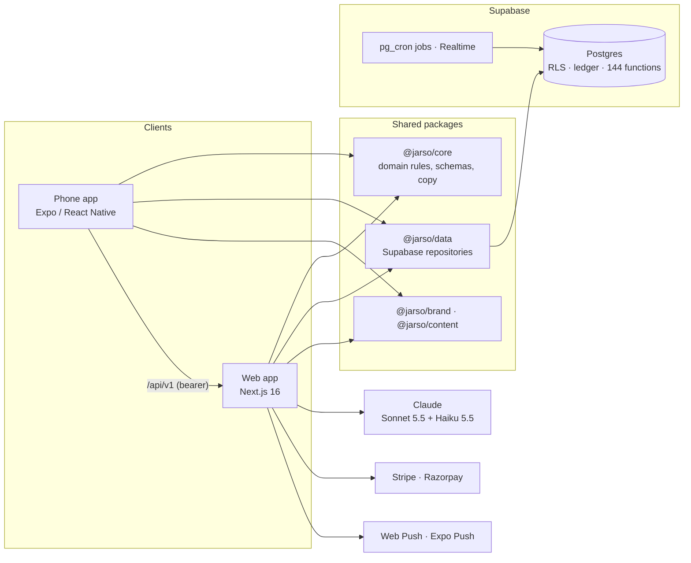

# Jarso

**Pocket money that teaches.** Jarso helps children aged 11–14 learn to manage money through real allowances, savings goals, everyday decisions and short interactive lessons, with a parent in the loop for every handover. It comes with Jarso, an AI money guide built on Claude.

**Live:** https://jarso.vercel.app · Built for the ATEX Playmaker's Hackathon · Scope: [REQUIREMENTS.md](./REQUIREMENTS.md)

## Two apps, one product, ten days

Two people built Jarso as **a full web app and a native phone app** in ten days (28 October to 6 November 2026). The phone app went from its first commit to children and parents, native push and native card payments in four of those days. It could move that fast because it reuses the web's domain logic, data layer, copy and design tokens through shared packages instead of rebuilding them.

| | |
| --- | --- |
| **Timeline** | 10 days, 252 commits, 138 merged pull requests |
| **Web app** | Next.js 16: 45 pages for children, parents and the public site |
| **Phone app** | Expo / React Native: 52 screens for children and parents, Android builds |
| **Shared core** | 6 workspace packages; `@jarso/core` holds 22 modules of rules, schemas and copy that both apps share word for word |
| **Database** | 42 tables, 144 Postgres functions, Row Level Security on every table, 63 migrations |
| **Tests** | 1,669 pgTAP database assertions · about 3,160 unit and component tests · 104 Playwright e2e tests · 24 Maestro phone flows · 201 AI-guide eval cases |
| **Decisions** | 18 architecture decision records, plus a design spec and plan for every major slice |

## Features

### For the child

**Money**
- **Spend and Save jars** drawn as real jars, with coins that fly between them and a clink when money moves.
- **A savings goal** shown as a coin staircase, one step per allowance, with the child's own saving plan, a live "payments left" estimate and a moment when the goal is reached.
- **"Your money ride":** an interactive graph of both jars over 7, 30 or 90 days, readable by tap or keyboard.
- **This week at a glance:** the diary opens on what was spent, what came in and where most of it went.
- **A money diary:** purchases and money received, with what-for categories, undo and traceable fixes (earlier versions are kept). "Where your money went" sums up the week in sentences.
- **Requests:** take money out of Save, put money in, or ask for extra in an emergency, each with a reason and the parent's answer; a waiting request can be cancelled.
- **Predict before deciding:** before a savings move, the child guesses its effect on the goal, then sees the real answer and a what-if slider.
- **Allowance-day plan:** on pocket-money day, a suggested Spend/Save split the child can accept with one tap.

**Learning**
- **A seven-day mission road** of interactive lessons: choices, amounts, sliders, sorting, matching and predictions, with instant feedback, hints, retries and a replay of missed steps.
- **Animated lesson films** with a recorded narrator and captions, plus read-aloud for any lesson step.
- **Topic pages, spaced practice and a check-in**, with skill levels kept apart from money.
- **A weekly review** and a gentle comeback question after days away.
- **Points, days in a row and "my bests"**: a board of one, so there's never a leaderboard and never a run "lost".
- **Coach characters**, sounds, a success dialog for right answers, and a **welcome tour** led by the child's own buddy.
- **A progress engine** in the database: Sparks, 10 levels, 23 badges and a forgiving streak, awarded inside the database (the app can't grant them) with daily caps, kept apart from money, and shown on the phone's Home.

**Jarso, the AI money guide**
- A full chat page and a Jarso buddy on every child screen, with replies that type themselves out, voice input, past chats and a thinking animation of coins dropping into the jar.
- It reads the child's own jars, allowance, history, rules, goal, requests and learning (read-only), and plans how to save for a price.
- **Jarso does tasks:** it prepares an action (a purchase, money received, a move between jars, a goal), and nothing happens until the child taps to confirm.
- **Photo price check:** photograph a price tag and Jarso offers a goal for it, with a "Make it my goal" card.
- **Answers that teach:** topic links, a quick check question, and what Jarso looked at to answer.
- **"Help me" and "Why?"** inside lessons, with a hint ladder that holds the answer back until the child has tried twice.
- **Memory** of short facts the child shares, visible to child and parent, with Forget.
- **"Jarso noticed":** weekly nudges for goal milestones, saving streaks and quiet spells.

### For the parent

- **A family dashboard:** Needs you, the family's jars and goals, the lesson road with each child on it, a money chart by child, spending by category and the next two weeks.
- **Jarso's family summary:** a short AI-written summary, labelled as AI, shown only when every number in it matches the data.
- **Allowances:** weekly, monthly, quarterly or yearly, with pause (until a date, with a message to the child), resume, change and stop; gifts planned for a future date; a handover that splits money into Spend and Save, or "not given".
- **Card handover** through Stripe or Razorpay (test mode), with provider logos, saved cards and auto charge.
- **Money rules:** spending limits, withdrawal caps, auto-approve, auto-confirm, an overspend switch, and a choice between "Ask me first" and "Just tell me" for jar moves.
- **Send a note** to a child, and **Match their saving** to reward money a child saved themselves.
- **Ask Jarso about a child**, read every chat (flagged ones first) and see what Jarso looked up; turn Jarso off per child. Jarso can also prepare a handover, gift, allowance change or request decision for the parent to confirm.
- **A child's learning at a glance:** where they are on the road, skill levels, the check-in summary and finished missions.
- **Family setup:** a parent adds a child, or a child starts from `/start` and the parent gets an email with a link and a 7-day code. PIN sign-in for children, renaming, PIN reset and child removal. Seven currencies and a family timezone.

### Everywhere

- **Notifications:** a live inbox over Supabase Realtime, with the child's big moments (missions finished, money in, goals reached, longest runs) at the top, handover reminders, web push and **native phone push**, with quiet hours for children and per-phone notification settings.
- **Works on slow and offline networks:** purchases and lesson answers queue on the device and send when back online.
- **Installable web app**, light and dark themes, reduced-motion support and child-first copy.
- **A scroll-driven landing page** with a coded hero, playable "How it works" demos, SEO and a sitemap, plus public [privacy](https://jarso.vercel.app/privacy) and [safety](https://jarso.vercel.app/safety) pages.

### On the phone

The Expo app brings the child and parent experiences to Android. Children get their jars, diary, goals, requests, missions, practice, weekly review, Jarso chat and news. Parents get the family home, handovers in cash or by card in a **native payment sheet**, gifts, allowances, rules, learning, the child's Jarso chats and their own Jarso chat. It has native push with quiet hours, an offline queue and dark mode.

The child side is built as a kid app of its own:

- **Home** is Jarso with one line to say, the child's streak and Sparks, moment cards (a yes from a parent, pocket money due, an ask waiting), Spend and Save tiles, the goal and today's mission.
- **A gold + button** opens "What happened?": buying, getting money, saving, using savings and asking for extra, each as a big keypad with quick chips and a picture grid, ending in a celebration with sound and haptics (and Undo where it applies).
- **Jar pages** with six weekly bars and one sentence about the week, and **a goal ring** with four milestone stars that cheer once each and a "weeks to go" estimate.
- **Learn as a quest map:** seven stops on a winding path with Jarso on today's stop, picture answer tiles, a green sheet for right and a calm blue one for "Close! Try again" (never red), and a chest at the end.
- **A daily check-in:** "Spend anything today?" on the first open of the day.
- **My asks:** a three-step tracker for every open request.

## Architecture



- **One domain, two apps.** Rules, schemas and every line of child and parent copy live in `@jarso/core`; data access lives in `@jarso/data` and takes a Supabase client as a parameter. The web and the phone run the same code, so they can't drift apart. Biome enforces package purity: no React, Next or platform globals in the core.
- **Feature modules with strict layers.** Route → service → repository → Supabase. Only repositories touch tables, modules talk only through index barrels, and server-only code is kept out of client bundles.
- **The database is the final authority.** Every table has Row Level Security with per-operation policies, and every money write is a checked Postgres function. Even a bug in app code cannot read another family's rows.
- **Money is a ledger.** Entries are append-only, in integer minor units, and balances are derived from them. Money counts only once a parent confirms a handover, and corrections are reversing entries. Concurrent confirmations can't double-post, which race tests prove.
- **The phone talks to Supabase directly** with the user's own session, so RLS applies (ADR 0016). It calls the web's `/api/v1` with a bearer token only for server work: the AI guide, the offline queue, payments and push.
- **Validated at every boundary.** Every input is parsed with Zod, errors are typed (`AppError`), and logging is structured with codes and ids, never raw messages.
- **Every decision is written down.** There are [18 ADRs](./docs/adr/) and a spec and plan per major slice in [`docs/superpowers/`](./docs/superpowers/).

## Safe by design, for children

- **Minimal data.** Children sign in with family code, nickname and PIN (no child email), and the PIN locks out after repeated attempts.
- **The AI guide is screened both ways.** Claude Sonnet 5.5 writes the answers, and Claude Haiku 5.5 screens every question and every reply (off topic, personal details, safety, jailbreaks). The guide never claims to have acted on its own. It also has helplines for safety topics, rate limits, daily and monthly budgets, a circuit breaker and a public safety page.
- **Kind gamification.** Rewards follow understanding, never the amount of money. There are no leaderboards, no lost streaks, no countdowns and no random rewards.
- **A clean public repo.** CI runs gitleaks, a pre-commit hook checks for secrets, and agent session logs are redacted.

## Engineering

| | |
| --- | --- |
| **Stack** | Next.js 16 (App Router, Cache Components) · React 19 · TypeScript (strict) · Supabase (Postgres, Auth, Realtime, pg_cron) · Expo / React Native · Tailwind v4 + shadcn/ui · NativeWind · TanStack Query · Zod · Biome · pnpm + Turborepo |
| **Layout** | `apps/web` (Next.js), `apps/mobile` (Expo), `packages/` (`core`, `data`, `brand`, `content`, `db`, `tsconfig`), `supabase/` (migrations, pgTAP tests) |
| **Quality** | TypeScript strict with no `any`, no `ts-ignore` and no `console.log`; Biome lint and format; Conventional Commits enforced by commitlint and the Semantic PR check |
| **Delivery** | CI on every PR (lint, typecheck, unit, build, gitleaks, pgTAP, sharded e2e on a fresh Supabase) · Vercel on `main` · migrations applied by the Supabase GitHub integration |

## Getting started

Prereqs: Node ≥ 22 (see `.nvmrc`), pnpm 10, Docker (for local Supabase).

```bash
pnpm install
cp .env.example apps/web/.env.local
pnpm db:start                    # local Supabase; copy publishable + secret keys into apps/web/.env.local
pnpm dev                         # http://localhost:3000
```

| Script | Does |
| --- | --- |
| `pnpm dev` / `build` | Web app |
| `pnpm mobile` | Expo dev server (see [docs/mobile.md](./docs/mobile.md)) |
| `pnpm lint` / `lint:fix` | Biome check / autofix |
| `pnpm typecheck` | Typecheck every workspace |
| `pnpm test` / `test:e2e` | Unit tests / Playwright |
| `pnpm check` | lint + typecheck + test |
| `pnpm eval:guide` | Run the AI guide evals (needs `ANTHROPIC_API_KEY`) |
| `pnpm db:start` / `db:stop` / `db:reset` / `db:test` | Local Supabase and pgTAP |
| `pnpm db:migration <name>` / `db:types` | New migration / regenerate DB types |

## Docs

Start at [docs/README.md](./docs/README.md): [architecture](./docs/architecture.md), [domain](./docs/domain.md), [design system](./docs/design.md), [database](./docs/database.md), [mobile](./docs/mobile.md), [security](./docs/security.md), [FR audit](./docs/fr-audit.md), [decision records](./docs/adr/). Deploy: [docs/deploy.md](./docs/deploy.md) (Vercel, Tokyo; Supabase `ap-northeast-1`).

## Team

Built by Pratyush Sharma and Haris Shakeel. Haris's work was written with Claude Code; every session's prompts and replies are in [`.claude-logs/`](./.claude-logs/).
