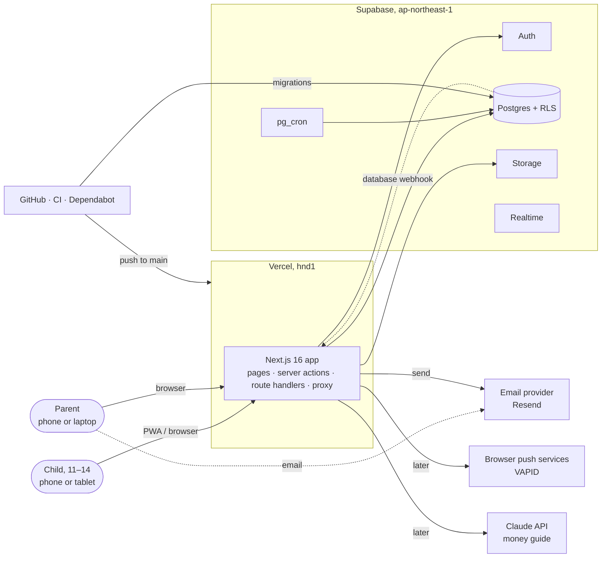
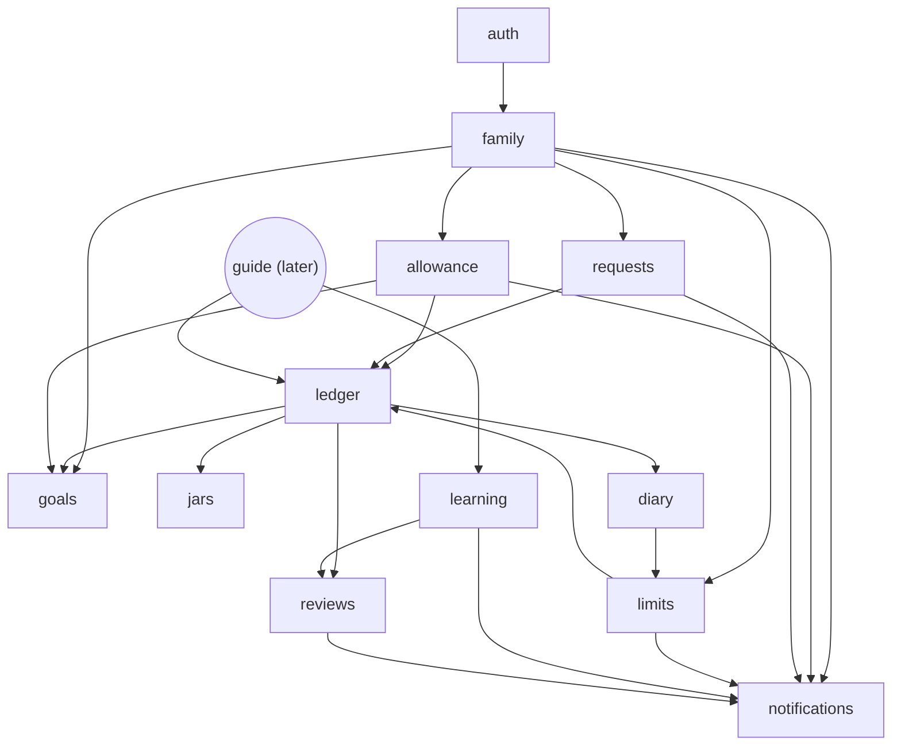
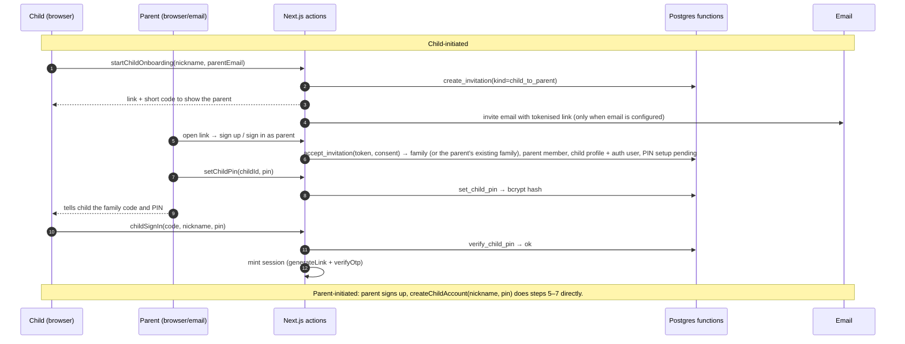

# Architecture

Jarso is a single Next.js 16 application on Vercel, backed by one Supabase project (Postgres, Auth, Storage, pg_cron, Realtime), with email through a transactional provider and, later, web push and the Claude API. This document is the map: who talks to what, which module owns which data, how money moves, and where every planned component lives. Product scope is `REQUIREMENTS.md`; domain terms and invariants are `docs/domain.md`; visual system is `docs/design.md`; operational posture is the `production-readiness` skill.

Diagrams are Mermaid and render on GitHub.

## 1. Principles

1. **One source of truth for money.** The append-only `ledger_entries` table. Balances are derived, never stored as the truth. Only three paths write to it: a parent's handover confirmation, a child's recorded entry (purchase, gift, correction), and a request reaching its final state. Each path is a Postgres function running in one transaction.
2. **Feature modules own their domain.** UI, validation, data access and business rules for one area live in `src/features/<name>/`. `src/app` routes and composes. Modules talk through barrels only.
3. **Authorization in three layers, the database last and loudest.** Proxy redirects optimistically, the data access layer verifies the user and role, Row Level Security decides. A bug in app code cannot read another family's rows.
4. **Records are authoritative, notifications are derived.** The inbox, email and push are projections of records. Delivery can fail; the record cannot be lost.
5. **Idempotent by construction.** Every balance-changing write carries a key with a unique constraint. Retries, double taps and cron reruns are no-ops.
6. **Small on purpose.** Sixty users, one region, one database, no queue broker, no second service. Escalation triggers are listed in the production-readiness skill.

## 2. System context



External dependencies and what happens when each is down:

| Dependency | Used for | If unavailable |
| --- | --- | --- |
| Supabase Postgres + Auth | everything | App shows the error boundary; nothing is written; no silent fallback. |
| pg_cron | due allowances, reminders, retention jobs | Occurrences generate late, never twice; next run catches up. |
| Email provider | parent reminders, request notices | Inbox still has the item; delivery rows retry with backoff and dead-letter after 5 attempts. |
| Browser push (later) | same events, opt-in | Inbox is the fallback by design (FR16). |
| Claude API | guide answers (ADR 0010) | Friendly fallback copy ("The guide is taking a break"); a circuit breaker after 5 failures a minute; topic material still available. |
| Vercel | hosting | Status page; nothing to do in-app. |

## 3. Runtime view

| Runtime piece | Where | Responsibility |
| --- | --- | --- |
| `src/proxy.ts` | Vercel edge of every request | Refresh Supabase session cookie; optimistic redirects for protected and auth routes; attach a request id header. No data access. |
| Server Components | Vercel function | Read data through services inside `<Suspense>`; never mutate. |
| Server Actions (`createAction`) | Vercel function | Mutations from our own UI: validate with Zod, `assertUser()`, call a service, `refresh()`. |
| Route Handlers (`withApi`) | Vercel function | Non-UI callers: cron triggers, webhooks, `/api/v1/*` for a future mobile app. CSRF origin check built in. |
| Postgres functions (`rpc`) | Supabase | Every multi-row money write, PIN verification, due generation, limit evaluation. One transaction each. |
| pg_cron jobs | Supabase | Hourly due-occurrence generation, reminder scheduling, notification dispatch kick, nightly retention and reconciliation. |
| Database webhook → `/api/hooks/notifications` | Supabase → Vercel | Fires on `notification_deliveries` insert so email goes out within seconds; cron sweeps anything missed. |
| Service worker (later) | Browser | Push subscription and offline shell for the installed PWA. |

Rendering model: `cacheComponents` is on. Anything reading cookies, headers or the user's rows is request-time and renders inside `<Suspense>`. Shared content (lesson topics, marketing) uses `"use cache"` with tags. Per-user data is never placed in a shared cache.

## 4. Code architecture

### 4.1 Layers

```
route / action / handler  →  service  →  repository  →  Supabase (RLS, functions)
        thin                business      only place that
                            rules         knows tables
```

- **Repository**: typed Supabase calls, row → domain mapping, every `error` checked and wrapped in `AppError`. Calls Postgres functions for writes that touch more than one row.
- **Service**: business rules, invariants that the database cannot express, composition across repositories of the same module. Takes a verified `SessionUser` or ids, never a request.
- **Entry points**: validate, authenticate, authorize at the role level, call one service, map errors. No SQL, no business rules.

### 4.2 Layout

```
src/
├── app/
│   ├── (marketing)/              # public pages
│   ├── (auth)/                   # login, signup (parent), child sign-in, invite acceptance
│   ├── (app)/                    # authenticated shell: header + bottom tab bar
│   │   ├── child/…               # home, jars, diary, learn, inbox, goal, requests
│   │   └── parent/…              # home, requests, allowance, family, limits, inbox
│   ├── api/
│   │   ├── health/               # shallow + deep health
│   │   ├── cron/[job]/           # CRON_SECRET-guarded triggers (fallback to pg_cron)
│   │   ├── hooks/notifications/  # database webhook receiver
│   │   └── v1/…                  # versioned API for non-UI callers
│   └── auth/
│       ├── callback/             # PKCE exchange (OAuth, same-browser links)
│       └── confirm/              # email link token-hash verify (any device)
├── features/
│   ├── auth/         ✅ sessions, DAL (requireUser/assertUser/requireRole), parent email auth
│   ├── profiles/     ✅ profile read/update (role and family never writable here)
│   ├── family/          families, members, invitations, child accounts + PIN, approval
│   ├── allowance/       schedules, due occurrences, handover confirmation, planned split
│   ├── ledger/          entries, balances, reservations, corrections; the only writer of money
│   ├── jars/            jar views, planned split preview, transfer entry points
│   ├── requests/        deposits, withdrawals, emergency requests and their lifecycle
│   ├── limits/          spending limits, post-purchase evaluation, limit notices
│   ├── goals/           goal, plan, payments-remaining estimate, what-if simulation
│   ├── diary/           diary UI over ledger entries (add, correct, undo)
│   ├── learning/     ✅ missions, topics, hints, spaced review, check-in, skill progress (ADR 0009)
│   ├── reviews/         weekly review generation and next-step recommendation
│   ├── notifications/   inbox, deliveries, channels (inbox, email, push), preferences
│   └── guide/        ✅ Claude-backed money guide with FR09 boundaries (ADR 0010)
├── components/ui/      shadcn primitives + brand components (JarsoMark, JarIllustration, Money, StatusChip)
├── config/             routes, site, env (Zod-validated), feature flags
├── lib/                errors, logger, createAction, api helpers, supabase clients, money formatting
├── content/            missions and topics as versioned JSON (see 5.3)
└── types/              generated database types
supabase/migrations/    schema, RLS, functions, cron registrations
```

Each feature keeps the fixed shape: `index.ts` (client-safe barrel), `schemas.ts`, `types.ts`, `components/`, `server/{index,actions,service,repository}.ts`.

### 4.3 Module dependency graph

Arrows mean "imports through the barrel". `ledger` has no dependencies on other domain modules; everything that moves money depends on it.



Writers of `ledger_entries`, enforced by which Postgres function may insert:

| Writer | Function | Kinds written |
| --- | --- | --- |
| `allowance` | `confirm_handover` | `allowance_in` to Spend and Save |
| `allowance` | `confirm_gift_handover` | `parent_gift_in` to Spend and Save |
| `requests` | `complete_request` | `deposit_out/in`, `withdrawal_out/in`, `grant_in` |
| `diary` | `record_entry`, `reverse_entry` | `purchase`, `gift_in`, `reversal` |

No other code path inserts into the ledger. The table's insert policy is `false` for all roles; only these `security definer` functions write, after their own authorization checks.

## 5. Data architecture

### 5.1 Entity model

```mermaid
erDiagram
  profiles ||--o{ family_members : "is member"
  families ||--o{ family_members : has
  families ||--o{ invitations : issues
  profiles ||--o| child_credentials : "child only"
  profiles ||--o| parent_details : "parent only"
  profiles ||--o{ allowance_schedules : "child has"
  allowance_schedules ||--o{ allowance_occurrences : generates
  profiles ||--o{ parent_gifts : "parent gives"
  profiles ||--o{ ledger_entries : "child owns"
  profiles ||--o{ requests : "child raises"
  profiles ||--o{ spending_limits : "child has"
  profiles ||--o{ goals : "child has"
  profiles ||--o{ mission_progress : tracks
  profiles ||--o{ review_items : scheduled
  profiles ||--o{ weekly_reviews : receives
  profiles ||--o{ notifications : receives
  notifications ||--o{ notification_deliveries : "sent via"
  profiles ||--o{ push_subscriptions : registers
  allowance_occurrences ||--o{ ledger_entries : "posts as"
  parent_gifts ||--o{ ledger_entries : "posts as"
  requests ||--o{ ledger_entries : "posts as"
  ledger_entries ||--o| ledger_entries : reverses

  profiles {
    uuid id PK "= auth.users.id"
    text role "parent | child, server-set"
    text display_name
    text nickname "child only, unique per family"
    text currency "ISO 4217, from family"
    timestamptz created_at
  }
  families {
    uuid id PK
    text code "6 chars, child sign-in"
    text currency
    text timezone "IANA name, default UTC"
    interval clock_offset "demo clock, default 0"
    bool demo_clock_enabled "seed or flagged action only"
    uuid created_by
  }
  child_settings {
    uuid child_id PK
    bool allow_negative_spend "default false, parent-set, audited"
  }
  family_members {
    uuid family_id FK
    uuid profile_id FK
    text role "parent | child"
    text status "invited | approved | removed"
    uuid approved_by
    timestamptz approved_at
    timestamptz removed_at
    uuid removed_by
    timestamptz consent_at "child rows, guardian consent"
    uuid consent_by "consenting parent"
  }
  invitations {
    uuid id PK
    uuid family_id FK "null when child-initiated"
    text kind "child_to_parent | parent_to_child"
    text parent_email "child-initiated only"
    text nickname
    text token_hash
    text short_code "shown by the child to the parent"
    text status "pending | accepted | expired"
    timestamptz expires_at
  }
  parent_details {
    uuid profile_id PK "parent, owner-only"
    date date_of_birth "18+"
    text country "ISO 3166-1 alpha-2"
    text gender
    timestamptz completed_at
  }
  child_credentials {
    uuid profile_id PK
    text pin_hash "bcrypt via pgcrypto"
    int failed_attempts
    timestamptz locked_until
    uuid set_by "parent"
  }
  allowance_schedules {
    uuid id PK
    uuid child_id FK
    uuid family_id FK
    bigint amount_minor
    text frequency "weekly | monthly | quarterly | annual"
    date starts_on
    date anchor_on "period stepping starts here; reset when the parent changes the schedule"
    int next_index "next period to generate, counted from anchor_on"
    text status "active | paused | stopped; one active or paused schedule per child"
    date paused_through "null = paused until the parent resumes"
    text pause_message "optional, max 140 chars, shown to the child"
  }
  parent_gifts {
    uuid id PK
    uuid family_id FK
    uuid child_id FK
    bigint amount_minor "planned amount, > 0"
    date give_on "today or later when created"
    text note "optional, max 140 chars"
    text status "pending | given | cancelled"
    bigint cash_minor "set at handover"
    bigint saved_minor "set at handover"
    uuid given_by
    timestamptz given_at
    uuid created_by "parent"
  }
  allowance_occurrences {
    uuid id PK
    uuid schedule_id FK
    text period_key "YYYY-MM-DD; unique with schedule"
    date due_on
    bigint amount_minor "schedule amount when generated"
    bigint shortfall_minor "due less cash and saved, default 0"
    text status "due | confirmed | closed = parent marked it not given; no ledger entry"
    bigint cash_minor
    bigint saved_minor
    uuid confirmed_by
    timestamptz confirmed_at
  }
  ledger_entries {
    uuid id PK
    uuid family_id FK
    uuid child_id FK
    text mode "recorded | practice"
    text jar "spend | save"
    text kind "allowance_in | gift_in | parent_gift_in | purchase | deposit_out | deposit_in | withdrawal_out | withdrawal_in | grant_in | reversal"
    text direction "in | out"
    bigint amount_minor "> 0"
    text label
    text source_type "occurrence | parent_gift | request | diary"
    uuid source_id
    uuid reverses_entry_id FK
    text idempotency_key "unique"
    uuid created_by
    timestamptz occurred_at
  }
  requests {
    uuid id PK
    uuid family_id FK
    uuid child_id FK
    text type "deposit | withdrawal | emergency"
    bigint amount_minor
    text reason
    text status "pending | approved | completed | rejected | cancelled"
    uuid decided_by
    timestamptz decided_at
    timestamptz completed_at
    text idempotency_key "unique"
  }
  spending_limits {
    uuid id PK
    uuid child_id FK
    text type "per_purchase | per_week | per_month; one active per child and type"
    bigint amount_minor
    bool active
  }
  goals {
    uuid id PK
    uuid child_id FK
    text title
    bigint price_minor
    text status "active | reached | archived"
    timestamptz reached_at
  }
  mission_progress {
    uuid child_id FK
    text mission_key "from content/"
    text status "started | completed"
    int score
    int hints_used
    timestamptz completed_at
  }
  review_items {
    uuid id PK
    uuid child_id FK
    text skill_key
    date due_on
    int interval_days
  }
  weekly_reviews {
    uuid child_id FK
    date week_start "unique with child"
    jsonb summary
    timestamptz generated_at
  }
  notifications {
    uuid id PK
    uuid recipient_id FK
    uuid family_id FK
    text type "due | reminder | limit_notice | request_new | request_decided | handover_done | mission"
    text subject_type
    uuid subject_id
    text title
    text body
    timestamptz read_at
  }
  notification_deliveries {
    uuid id PK
    uuid notification_id FK
    text channel "inbox | email | push"
    text status "queued | sent | failed | dead"
    int attempts
    timestamptz next_attempt_at
    text last_error
  }
  push_subscriptions {
    uuid id PK
    uuid profile_id FK
    text endpoint "unique"
    jsonb keys
  }
```



Also: `usage_counters` (rate limits, later the guide's token budget), `job_runs` (one row per cron run with counts and duration), `audit_log` (parent-controlled setting changes: schedule, pause, stop, not-given, limits, PIN resets).

RLS on `parent_gifts`: only a parent of the child can select rows; a child never reads the table and sees a given gift through its ledger rows (label = note). Nobody writes the table directly; creating, editing, cancelling and handing over a gift are `security definer` functions. A pending gift is therefore invisible to a child session, including through counts and totals.

The next due date of a schedule is computed from `anchor_on` and `next_index` (stepping by frequency, clamping day 29–31), not stored.

### 5.2 Derived values

| Value | How | Where |
| --- | --- | --- |
| Jar balance | `sum(in) - sum(out)` over `ledger_entries` for `(child_id, jar, mode = recorded)` | SQL function `balance(child_id, jar)`; indexed on `(child_id, mode, jar, occurred_at desc)` |
| Reserved Save | `sum(amount)` of `requests` where `type = withdrawal` and `status in (pending, approved)` | SQL function `reserved_save(child_id)` |
| Available Save | balance(save) − reserved | SQL function; also the cap checked at request and completion |
| Goal progress | available Save vs `goals.price_minor` | `goals` service |
| Payments remaining | ceil((price − available Save) / the child's planned save per allowance) | `goals` service, pure function with tests. The child's plan is deferred (FR02), so the estimate lands with it |
| Due now | For a parent: `allowance_occurrences` with `status = due`, plus `parent_gifts` with `status = pending` and `give_on <= family today`. For a child: due occurrences only; gifts never count until given | query; drives badges. No cron needed for gifts, since their due state is derived |

Sixty children at ten entries a day is about 220k rows a year; summing per child stays in single-digit milliseconds with the index. A maintained balance column is a later optimisation, reconciled nightly by `job_runs` if ever added.

### 5.3 Content

Missions, topics and hints are authored as versioned JSON under `src/content/` (validated by Zod at build time) so they ship with the code, are reviewable in PRs, and need no admin UI. Only progress lives in the database, keyed by `mission_key` and `skill_key`. When content changes, keys stay stable; a mission is retired by flag, never deleted. Built in ADR 0009: `src/content/learning` holds seven missions, five topics, a review pool and the check-in; `features/learning/content.ts` parses them on the server and pages pass the one mission or set a child needs to the player, so content is never in a shared client bundle. Progress tables: `mission_attempts`, `step_results`, `skill_progress`, `review_items`, `practice_results`, `learning_checkins` (`docs/database.md`).

### 5.4 Practice money

Practice entries live in the same `ledger_entries` table with `mode = practice`. Every balance function takes `mode` and defaults to `recorded`. A check constraint forbids `mode = practice` on entries with `source_type in (occurrence, parent_gift, request)`, so practice money can never originate from a handover or a parent gift. Practice money is deferred to the learning section (FR05/FR06) and is not built in the first milestone. The UI shows the practice chip whenever `mode = practice` (design.md 2.5).

## 6. Authentication and authorization

### 6.1 Identities

| Actor | Supabase Auth identity | Sign-in |
| --- | --- | --- |
| Parent | Email + password (OAuth later), PKCE callback | `/login` |
| Child | Real `auth.users` row created by the parent through the admin client, with a synthetic non-deliverable email (`<uuid>@child.jarso.invalid`) and a random unguessable password the child never sees | `/child/sign-in`: family code + nickname + PIN |

Child sign-in flow: the Server Action looks up the child by family code and nickname, calls `verify_child_pin(profile_id, pin)` which checks the bcrypt hash, increments `failed_attempts`, and sets `locked_until` after five failures for fifteen minutes. On success the server mints a session with `auth.admin.generateLink({ type: "magiclink" })` and `auth.verifyOtp({ token_hash })`, so the cookie session is a normal Supabase session scoped to the child's identity. PINs are set and reset by a parent only. Nothing about this path exposes a password to the child or stores the PIN in plain text.

### 6.2 Roles and membership

`profiles.role` and `family_members` are set only by `security definer` functions (`create_family`, `register_child`, `remove_child`, `rename_child`, `update_family_timezone`). The profile update policy grants `update` on `display_name`, `avatar_url` and preferences columns only; role and nickname are not in the column grant. `updateProfileSchema` never includes them.

RLS helper predicates, all `stable` and `security definer`:

- `is_approved_member(family_id)`: the caller has an approved `family_members` row for this family.
- `is_parent_of(child_id)`: caller is an approved parent in the child's family.
- `is_self(child_id)`: caller is the child.

| Table | select | insert | update | delete |
| --- | --- | --- | --- | --- |
| profiles | self, or parent of | trigger only | self (limited columns) | never |
| families, family_members | approved members | functions only | functions only | functions only |
| allowance_schedules, spending_limits | child or parent of | parent of | parent of | parent of (soft) |
| allowance_occurrences | child or parent of | functions only | functions only | never |
| ledger_entries | child or parent of | functions only | never | never |
| requests | child or parent of | child (self) via function | functions only | never |
| goals, mission_progress, review_items | self or parent of (read) | self | self | self (goals archive only) |
| notifications | recipient | functions only | recipient (`read_at` only) | never |
| notification_deliveries, push_subscriptions | service role; subscriptions: self | self (subscriptions) | service role | self (subscriptions) |

The DAL mirrors this at the app layer: `requireUser()` for pages, `assertUser()` for actions and handlers, plus `requireRole("parent" | "child")` and `assertParentOf(childId)` so a wrong-role request fails before the database is asked.

## 7. Key flows

### 7.1 Onboarding



### 7.1a Parent profile completion (ADR 0008)

After sign-up, the `(app)` layout's profile gate shows a non-dismissible dialog to any parent without a `parent_details` row; `complete_parent_profile()` saves date of birth, country and gender, and `refresh()` removes the dialog. Until then the app server refuses parent actions through `assertRole("parent")` (exceptions: completing the profile, sign-out, own display name). Database-level enforcement arrives with the money functions (ADR 0008).

### 7.1b Removing a child (ADR 0007)

Parent settings → "Remove" → confirmation dialog → `removeChild` service: `remove_child()` disables the child in one transaction (membership `removed`, nickname freed, credentials and PIN attempts deleted, audit `child.removed`; idempotent for retries) and returns whether the identity may be deleted; then `revoke_user_sessions()` ends every device; then, while there is no money history, the auth user is deleted and its profile cascades. Rename (`rename_child`) and the family timezone (`update_family_timezone`) follow the same parent-only, audited pattern.

### 7.2 Allowance falls due and is handed over

```mermaid
sequenceDiagram
  autonumber
  participant CR as pg_cron (hourly)
  participant DB as Postgres
  participant N as notifications
  participant P as Parent UI
  participant A as Server Action
  CR->>DB: generate_due_occurrences()
  DB->>DB: insert allowance_occurrences (schedule_id, period_key) on conflict do nothing
  DB->>N: notifications(type=due) for child and parent; deliveries(inbox, email)
  P->>A: confirmHandover(occurrenceId, cashMinor, savedMinor, idemKey)
  A->>A: assertUser, assertParentOf(child)
  A->>DB: confirm_handover(...)
  DB->>DB: lock occurrence; require status=due; 0 < cash+saved <= due amount; shortfall = due - (cash+saved)
  DB->>DB: insert ledger allowance_in (spend, cash), allowance_in (save, saved) with idempotency keys
  DB->>DB: occurrence → confirmed (closed, shortfall stored); notifications(handover_done)
  A->>P: refresh(); jar fill animation
```

Gifts use the same handover screen and flow. A parent gift has no occurrence or generator: it is due when `status = pending` and `give_on <= family today`. `confirm_gift_handover` locks the gift row, requires it to be due, takes `(cash, saved, idemKey)` with `cash, saved >= 0` and `cash + saved > 0`, and posts `parent_gift_in` entries with `source_type = parent_gift`. It records what the parent actually gave, more or less than planned, with no shortfall (a 100× sanity cap guards against typos). The row becomes `given`. Until then the child cannot see it. Edit and cancel are parent-only and refused once given.

Not given: a parent-only function locks a due occurrence, sets it `closed` with who and when, posts nothing and writes `audit_log`. It is refused unless the occurrence is due, and it races safely with `confirm_handover`: exactly one wins. This refines the rule that missed occurrences stay due one by one: they stay due until the parent hands over or marks them not given.

Pause, resume, change and stop are parent-only functions that write `audit_log`. Pause, resume and stop first catch the schedule up to family-today, so every period up to and including that day becomes due (and stays due) however late the hourly job ran. While a schedule is `paused`, `generate_due_occurrences` skips it, except for auto-resume once `paused_through` is in the past. Periods that fall inside a pause are never generated and are not paid later. Occurrences already due stay due after a pause or stop.

Reminders: a second cron job (`send_handover_reminders`, hourly) creates a `reminder` notification when `today - due_on` is a positive multiple of 3 days (family timezone) for an occurrence still `due`, idempotent on `(occurrence_id, reminder_date)`. The `due` notice itself goes out the day it falls due. The interval is fixed at 3 for now. `due_on` and these day counts use the family timezone (`families.timezone`); monthly, quarterly and annual dates on day 29–31 clamp to the month's last day.

Demo clock: `family_now(family_id)` returns `now() + families.clock_offset`, and every time-based function uses it. A parent-only action advances the offset (forward only) and runs generation and reminders for that family. It exists only when `FEATURE_DEMO_CLOCK` is on and the family's `demo_clock_enabled` flag is set.

### 7.3 Purchase and limit notice

```mermaid
sequenceDiagram
  autonumber
  participant C as Child UI
  participant A as Server Action
  participant DB as Postgres
  C->>A: recordPurchase(amount, label, idemKey)
  A->>DB: record_entry(kind=purchase, jar=spend)
  DB->>DB: lock child (advisory); refuse insufficient_spend if spend - amount < 0 and not allow_negative_spend
  DB->>DB: insert ledger (never blocked by limits)
  DB->>DB: evaluate_limits(entry) → if breached, notifications(limit_notice) to parents
  A->>C: refresh(); balance updates
```

### 7.4 Request lifecycle (deposit, withdrawal, emergency)

```
pending ──(parent approves)──► approved ──(parent confirms hand over / receipt)──► completed ──► ledger posts
   │                                 │
   ├──(parent rejects)──► rejected   └──(parent rejects)──► rejected
   └──(child cancels)───► cancelled
```

Withdrawal cap is checked against `available_save` at `pending` and again inside `complete_request`; deposits are checked against the Spend balance the same way, and never take Spend below zero even when overspending is allowed. `complete_request` is the only transition that writes to the ledger, and it is idempotent on the request id.

## 8. Notifications

```mermaid
flowchart LR
  rec[(record change<br/>function)] --> n[(notifications)]
  n --> d[(notification_deliveries<br/>inbox · email · push)]
  d -->|inbox row is the inbox| ui[Inbox tab + badge]
  d -->|webhook on insert| disp[/api/hooks/notifications<br/>dispatcher]
  cr[pg_cron sweep<br/>every 10 min] --> disp
  disp -->|Resend| mail[Parent email]
  disp -->|web-push, VAPID| push[Browser push]
  disp -->|status, attempts, next_attempt_at| d
```

- Notifications are created inside the same transaction as the record change, so a posted handover always has its notification.
- The inbox is just `notifications` filtered by recipient; no delivery step can lose it.
- Email goes to parents for `due`, `reminder`, `request_new` and `limit_notice`; children get inbox only in the pilot. Batching rule: at most one email per parent per hour, grouping pending items.
- Push is opt-in per device (`push_subscriptions`), added later in the pilot with the PWA.
- The dispatcher is idempotent per delivery row and backs off (1, 5, 30, 120 minutes), then marks `dead`. A weekly query lists dead deliveries.
- Preferences per profile (`notification_prefs` jsonb on `profiles`) can mute email per type; the inbox cannot be muted.

## 9. Scheduling

| Job | Schedule | Function | Idempotency |
| --- | --- | --- | --- |
| `generate_due_occurrences` | hourly | creates occurrences whose `due_on <= today` for active schedules; skips paused ones and auto-resumes them after `paused_through` | unique `(schedule_id, period_key)` |
| `send_handover_reminders` | hourly | reminder notifications for stale `due` occurrences | one per occurrence per day |
| `dispatch_notifications` | every 10 min | sweeps `queued` and retryable deliveries (webhook does the fast path) | per delivery row |
| `schedule_reviews` | nightly | spaced-repetition items due tomorrow | unique `(child_id, skill_key, due_on)` |
| `generate_weekly_reviews` | weekly | FR11 summaries | unique `(child_id, week_start)` |
| `reconcile_and_retain` | nightly | balance sanity checks, expire invitations, prune `job_runs` | n/a |

All jobs run in `pg_cron` with `job_runs` rows for observability. If a job needs app code (Claude, email), it enqueues deliveries or rows and `/api/cron/[job]` (guarded by `CRON_SECRET`) does the app-side work; the Vercel Hobby plan's cron limits are the reason the schedule itself lives in Postgres.

## 10. Cross-cutting concerns

| Concern | Mechanism | Reference |
| --- | --- | --- |
| Validation | Zod on every input; `createAction`, `withApi` + `parseBody` | `docs/api.md` |
| Errors | `AppError(code)` mapped to results and HTTP; raw errors never shown | `docs/conventions.md` |
| Logging | structured `logger` with request id and `userId`; no PII | `docs/security.md` |
| Caching | `"use cache"` + tags for shared content; request-time for user data; `refresh()` after mutations | production-readiness skill |
| Idempotency | keys on ledger and requests; natural keys on cron outputs | section 5 |
| Rate limits | `usage_counters` for PIN attempts (also `child_credentials`), request creation, future guide | production-readiness skill |
| CSRF / CORS | Server Action origin checks; `withApi` origin guard; no permissive CORS | `docs/security.md` |
| Secrets | host env vars only; public repo controls; redacted session logs | `docs/security.md` |
| Feature flags | `FEATURE_*` env vars validated in `env.server.ts`; `feature_flags` table when per-family rollout is needed | production-readiness skill |
| Money formatting | `Money` component and `formatMinor()`; integers end to end | `docs/design.md` |
| Accessibility | AA, 44 px targets, reduced motion | `docs/design.md` |
| Network resilience | time limits on every call, device outbox for child self-recording | section 10.1 |

### 10.1 Network resilience

Children use school or home Wi-Fi and parents use mobile data, so slow and dropped connections are normal. Two rules: nothing waits forever, and a child's own record survives a dropped connection. Design and decisions: `docs/superpowers/specs/2026-10-30-network-resilience-design.md`.

- **Time limits.** Every Supabase client uses `createTimedFetch` (`src/lib/timed-fetch.ts`): 8 s per call, and a timeout or network failure becomes a 503 `JA503` response mapped to `AppError("UNAVAILABLE")`. Postgrest retries are off. Calls over 1 s, timeouts and network failures log a `warn` with name, path, status and duration only. A guide turn has a 45 s deadline shared by every Claude call, under `maxDuration = 60` on the pages that can ask the guide.
- **Online-only actions.** `runOnline` / `useOnlineActionState` (`@/features/offline`) race a Server Action against 15 s. Offline, a dropped connection or a slow reply returns a calm `UNAVAILABLE` result ("You're offline, try again when connected" or "This is taking a while. Try again?"), and the form keeps what was typed. This covers everything that moves or controls money (handover, gifts, allowance, rules, undo purchase), account and family settings, sign-in/out and the money guide.
- **Device outbox.** Purchases, mission steps, mission completion, practice results and check-ins go through an IndexedDB outbox scoped to the signed-in user id. Each item keeps its idempotency key and device time (`occurredAt`) and is sent one at a time to `POST /api/v1/outbox` under a Web Lock, with 15 s per send and backoff 2 s, 5 s, 15 s, 30 s, then 60 s. It flushes on app start, `online`, tab focus and after any successful request. The server clamps `occurredAt` (up to 60 s ahead becomes `now()`, further ahead or over 7 days back is refused with `22023`) and replays a known key without moving money twice. A refused purchase stays in the diary as "Needs a look"; items expire after 7 days or 20 attempts. The outbox never sends another user's items.
- **Slow pages.** Page fallbacks switch to "This is taking a while. Try again?" after 10 s; Try again refreshes the route, then reloads if it is still stuck. A stale Server Action after a deploy shows "Jarso was updated. Refresh to continue."
- **Out of scope.** No Service Worker, web manifest or `experimental.useOffline`: opening Jarso cold with no network shows the browser's offline page, and nothing sends in the background while the app is closed.

## 11. Environments and delivery

| Environment | App | Database | Notes |
| --- | --- | --- | --- |
| Local | `pnpm dev` | Supabase in Docker (`pnpm db:start`), migrations + `seed.sql` | Inbucket catches email. |
| Preview | Vercel preview per PR | **Production project** (pilot decision) | Test families are flagged `families.is_test = true` and excluded from metrics; previews never run cron (pg_cron is in the database, shared, by design). Revisit with a staging project or Supabase Branching if real families join before the pilot ends. |
| Production | Vercel `hnd1`, https://jarso.vercel.app | Supabase `sbnakvwvaymzypwmpqzv`, `ap-northeast-1` | `docs/deploy.md` |

Delivery pipeline: PR → CI (lint, typecheck, unit, build, e2e, gitleaks, migration reset + pgTAP) → review → squash merge to `main` → in parallel, Supabase's GitHub integration applies new migrations to the hosted project (production branch `main` only, no preview databases) and Vercel builds and promotes. Migrations are expand/contract so the previous build keeps working during the minute both run. Rollback is Vercel's promote-previous; schema never rolls back.

## 12. Observability and operations

- Uptime monitor on `/api/health?deep=1` (runs a trivial query).
- Error tracking (Sentry free tier) on client and server with source maps.
- `job_runs` and `notification_deliveries` are the operational tables; two saved SQL queries ("failed jobs last 7 days", "dead deliveries") are the dashboard.
- Metrics for the pilot evaluation come from SQL over `families`, `allowance_occurrences` (due → confirmed lag), `requests` (unanswered), `mission_progress`, and a nightly reconciliation of balances versus ledger sums.
- SLOs: 99.5 % availability of the deep health check; p95 dashboard under 2 s from Japan and the pilot country.

## 13. Testing strategy

| Layer | What | How |
| --- | --- | --- |
| Postgres functions and RLS | invariants: exactly-once posting, caps, family isolation, role immutability | pgTAP tests run by the CI `migrations` job against a reset database, with two families and three users |
| Services | plans, estimates, limit evaluation, request transitions | Vitest with repository mocks |
| Schemas | every Zod schema | Vitest |
| Components | behaviour by role | Testing Library |
| Flows | onboarding both ways, due → handover, purchase → notice, withdrawal lifecycle, with push disabled | Playwright against local Supabase with seeded families |
| Security | cross-family access attempts, child calling parent actions, PIN lockout | Playwright + pgTAP |

## 14. Roadmap mapping

| Milestone | Modules | Tables and functions | Screens |
| --- | --- | --- | --- |
| **First milestone** (FR13, FR01, FR03, FR14 purchases + deposits + withdrawals, FR16 inbox) | `family`, `allowance`, `ledger`, `jars` (read), `diary` (purchases), `requests` (withdrawal, deposit), `limits`, `notifications` (inbox + email), demo clock | families, family_members, invitations, child_credentials, child_settings, allowance_schedules/occurrences, ledger_entries, requests, spending_limits, notifications, notification_deliveries, job_runs; functions `create_child_account`, `accept_invitation`, `verify_child_pin`, `generate_due_occurrences`, `confirm_handover`, `record_entry`, `evaluate_limits`, `complete_request`, `family_now`, `send_handover_reminders` | parent: onboarding with child switcher, family, allowance setup, home with due + requests, handover sheet, limits and overspend toggle, demo clock, inbox; child: sign-in, home, jars, record purchase, request withdrawal or deposit, inbox |
| **Rest of pilot** (FR02, FR04–FR06, FR08, FR10–FR12, FR15, push, PWA) | `goals`, `diary` full, `learning`, `reviews`, `requests` (emergency), `notifications` (push), PWA shell | goals, mission_progress, review_items, weekly_reviews, push_subscriptions, `reverse_entry`, review jobs | goal, diary, missions, topics, weekly review, emergency request, settings |
| **Later** (FR07, FR09) | `guide` | usage_counters (token budgets), guide_messages | guide chat with streaming |

## 15. Decisions and assumptions

Decided with the product owner on 2026-10-28:

- Child identity: parent-created Supabase user with family code + nickname + PIN sign-in; no child email (ADR 0004).
- Family model: `families` hub with many parents and many children (ADR 0005).
- Environments: one hosted project; previews share it for the pilot.
- Notification channels: inbox for everyone, email for parent actions, push later (ADR 0006).

Assumed by the architecture, to be confirmed when first implemented:

- Balances derived from the ledger, not stored; reservations derived from `requests`.
- `pg_cron` owns schedules; app-side cron is a guarded fallback.
- Mission content as versioned JSON in the repo.
- Practice money in the same ledger table under `mode`.
- Email provider is Resend; swap is a single adapter in `notifications/server/channels`.

Also decided on 2026-10-28 (see REQUIREMENTS.md "Decided for the pilot"):

- Partial handovers close the occurrence and record `shortfall_minor`; over-handover is rejected.
- Purchases that would take Spend below zero are refused unless `child_settings.allow_negative_spend` is on.
- Limit types are per purchase, per week and per month; weeks and months follow the family timezone.
- Reminders every 3 days from the due date; missed occurrences stay due separately; schedule changes apply from the next occurrence.
- Parent verification is email confirmation plus a stored guardian-consent checkbox.
- Savings deposits are in the first milestone; a parent can link several children; invitations always give a link and short code.
- A per-family demo clock (feature-flagged) lets the demo fast-forward time.

Open questions carried from `REQUIREMENTS.md`: pilot countries and stronger parental verification, emergency grant jar, pilot thresholds.

## 16. Scaling notes

- Grow by adding feature modules, not by growing `lib/`.
- Features import other features only through barrels; if two become entangled, extract a third.
- The backend seam is `features/*/server`: services take plain inputs and return domain types, so a mobile app or a separate API can reuse them behind `/api/v1`.
- Revisit this document at the escalation triggers in the production-readiness skill: roughly 1,000 daily active users, 10 GB of data, a second region, or a second deployable.
