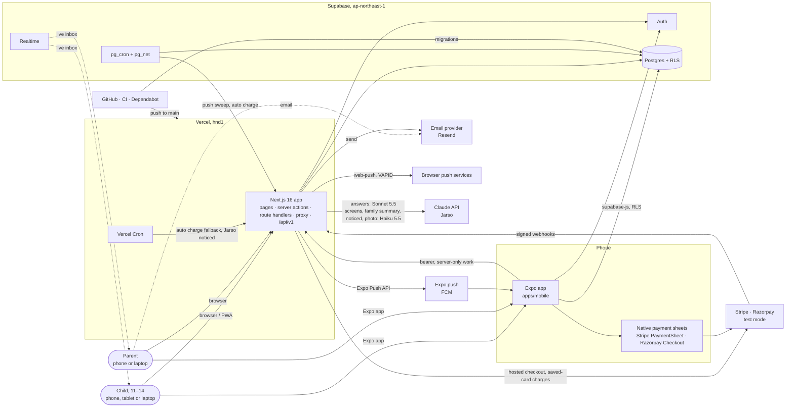
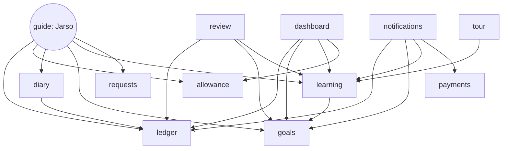
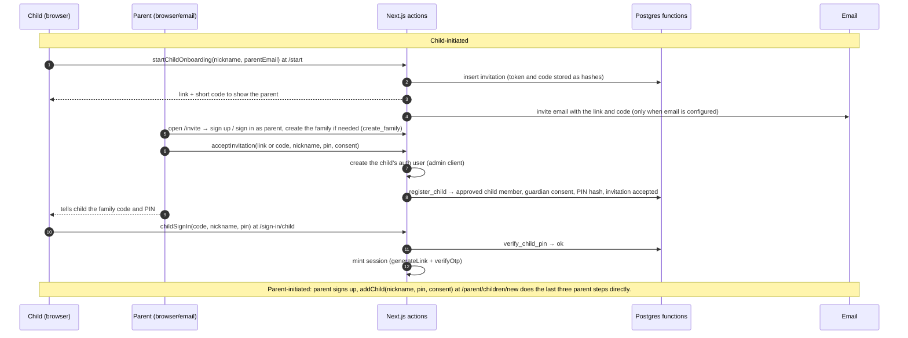

# Architecture

Jarso is a Next.js 16 web application on Vercel and an Expo phone app (`apps/mobile`), both backed by one Supabase project (Postgres, Auth, pg_cron, pg_net, Realtime), with email through a transactional provider (invitations), web push (VAPID), phone push through Expo, card payments through Stripe and Razorpay (test mode) and the Claude API. This document is the map: who talks to what, which module owns which data, how money moves, and where every component lives. Product scope is `REQUIREMENTS.md`; domain terms and invariants are `docs/domain.md`; visual system is `docs/design.md`; operational posture is the `production-readiness` skill.

Diagrams are Mermaid and render on GitHub.

## 1. Principles

1. **One source of truth for money.** The append-only `ledger_entries` table. Balances are derived, never stored as the truth. Only three paths write to it: a parent's handover confirmation (cash, or a card payment the provider reports), a child's recorded entry (purchase, gift, correction), and a request reaching its final state. Each path is a Postgres function running in one transaction.
2. **Feature modules own their domain.** Rules, schemas and copy for one area live in `packages/core/src/<name>`, its shared Supabase reads and writes in `packages/data/src/<name>`, and its UI and server code in `apps/web/src/features/<name>/` (and `apps/mobile/src/features/`). `apps/web/src/app` and `apps/mobile/app` route and compose. Modules talk through barrels only.
3. **Authorization in three layers, the database last and loudest.** Proxy redirects optimistically, the data access layer verifies the user and role, Row Level Security decides. A bug in app code cannot read another family's rows.
4. **Records are authoritative, notifications are derived.** The inbox and push are projections of records. Delivery can fail; the record cannot be lost.
5. **Idempotent by construction.** Every balance-changing write carries a key with a unique constraint. Retries, double taps and cron reruns are no-ops.
6. **Small on purpose.** Sixty users, one region, one database, no queue broker, one server deployable. Escalation triggers are listed in the production-readiness skill.

## 2. System context



External dependencies and what happens when each is down:

| Dependency | Used for | If unavailable |
| --- | --- | --- |
| Supabase Postgres + Auth | everything | App shows the error boundary; nothing is written; no silent fallback. |
| pg_cron + pg_net | due allowances, reminders, guide retention, the push sweep and card auto charge (section 9) | Occurrences generate late, never twice; next run catches up. |
| Vercel Cron | daily auto-charge fallback, weekly Jarso noticed (section 9) | The next run catches up; a repeat is harmless. |
| Email provider | invitation email (notices go to the inbox and push) | Invitation code still shows on screen. |
| Browser push | inbox events, opt-in per browser (ADR 0012 web push) | Inbox is the record by design (FR16); a failed send is logged by status and not retried. |
| Expo Push API | inbox events on phones that allowed notifications | Same as browser push: the inbox has the row; a `DeviceNotRegistered` token is forgotten. `EXPO_PUSH=off` stops sending. |
| Payment providers (Stripe, Razorpay, test mode; several can be on) | Card handover and auto charge on the web and in the phone's native sheets (ADR 0013, 0014, 0018) | Card actions say they are unavailable; cash handover is unchanged; a due item stays due; webhooks are retried by the provider. |
| Claude API | Jarso's answers (Sonnet 5.5) and look-ups; input and output screens, the family summary, Jarso noticed rewording and the photo price check (Haiku 5.5) (ADR 0010, 0011) | Friendly fallback copy ("Jarso is taking a break"); a circuit breaker after 5 failures a minute; topic material still available; the summary is left out and noticed sends its fixed line. |
| Vercel | hosting | Status page; nothing to do in-app. |

## 3. Runtime view

| Runtime piece | Where | Responsibility |
| --- | --- | --- |
| `apps/web/src/proxy.ts` | Vercel edge of every request | Refresh Supabase session cookie; optimistic redirects for protected and auth routes; attach a request id header. No data access. |
| Server Components | Vercel function | Read data through services inside `<Suspense>`; never mutate. |
| Server Actions (`createAction`) | Vercel function | Mutations from our own UI: validate with Zod, `assertUser()`, call a service, `refresh()`. |
| Route Handlers (`withApi`) | Vercel function | Non-UI callers: the cron routes, the device outbox, Jarso's turns, payment webhooks, and `/api/v1/*` for the phone app's server-only work (`docs/api.md`). CSRF origin check built in; bearer routes opt in per ADR 0017. |
| Postgres functions (`rpc`) | Supabase | Every multi-row money write, PIN verification, due generation, limit evaluation. One transaction each. |
| pg_cron jobs | Supabase | Hourly due-occurrence generation and reminders, daily guide retention (section 9). |
| pg_cron (`push-sweep`) → `/api/cron/push` | Supabase pg_cron + pg_net | Sweep every 15 minutes that pushes any notice of the last day no action pushed, including a child's notices held overnight (`CRON_SECRET`). Actions push their own notices right away with `after()`. |
| pg_cron (`charge-due-cards`) → `/api/cron/payments/auto-charge` | Supabase pg_cron + pg_net | Hourly at :09: charges saved cards for items that fell due with auto charge on. A daily Vercel Cron on the same route is the fallback. |
| Vercel Cron | Vercel | Daily auto-charge fallback, and Jarso noticed (`/api/cron/guide/noticed`) on Sunday at 17:00 UTC. Both need `CRON_SECRET`. |
| Service worker (`public/sw.js`) | Browser | Shows a push and opens the notice's record. Caches nothing; the device outbox is the offline story. |
| Expo app (`apps/mobile`) | Phone | 52 screens for children and parents. Reads and writes Supabase directly under RLS (ADR 0016); calls `/api/v1` only for work that needs a server secret; receives push through Expo; pays by card in native sheets (ADR 0018). |

Rendering model: `cacheComponents` is on. Anything reading cookies, headers or the user's rows is request-time and renders inside `<Suspense>`. Shared content (lesson topics, marketing) uses `"use cache"` with tags. Per-user data is never placed in a shared cache.

## 4. Code architecture

### 4.1 Layers

```
route / action / handler  →  service  →  repository  →  Supabase (RLS, functions)
        thin                business      only place that
                            rules         knows tables
```

- **Repository**: typed Supabase calls, row → domain mapping, every `error` checked and wrapped in `AppError`. Calls Postgres functions for writes that touch more than one row.
- **Service**: business rules, invariants that the database cannot express, composition across repositories of the same module. Takes a verified `SessionUser` or ids, never a request.
- **Entry points**: validate, authenticate, authorize at the role level, call one service, map errors. No SQL, no business rules.

### 4.2 Layout

```
apps/web/src/
├── app/                          # routes only; see section 4.4 for every page
│   ├── (marketing)/              # landing, privacy, safety
│   ├── (auth)/                   # login, signup (parent), start (child-started onboarding), sign-in/child
│   ├── (app)/                    # authenticated shell: header, rail or bottom tab bar
│   │   ├── child/…               # Home, diary, goal, requests, learn, Jarso, inbox, settings
│   │   ├── parent/…              # Home, children, money, Jarso, inbox, settings, setup, payments
│   │   └── dashboard, settings, invite   # role routers and invitation acceptance
│   ├── api/
│   │   ├── health/               # shallow + deep health
│   │   ├── cron/payments/auto-charge/  # CRON_SECRET-guarded auto charge (pg_cron via pg_net, Vercel Cron fallback)
│   │   ├── cron/push/            # CRON_SECRET-guarded push sweep (pg_cron, 15 min)
│   │   ├── cron/guide/noticed/   # CRON_SECRET-guarded Jarso noticed (Vercel Cron, weekly)
│   │   ├── v1/auth/child-sign-in # child PIN sign-in that returns session tokens (mobile; needs the service key)
│   │   ├── v1/notices/dispatch   # bearer-authed push sweep after a mobile action (needs the service key)
│   │   ├── v1/payments/…         # webhooks/[provider] (signature-guarded), razorpay/return (cross-origin form post, redirect only), in-app sheets, cards, auto charge
│   │   └── v1/…                  # versioned API for the phone and other non-UI callers (docs/api.md)
│   ├── auth/
│   │   ├── callback/             # PKCE exchange (OAuth, same-browser links)
│   │   └── confirm/              # email link token-hash verify (any device)
│   └── dev/payments/fake/        # the fake provider's checkout (dev and e2e only)
├── features/         # see 4.2a for what each module owns
│   ├── allowance/  auth/  dashboard/  diary/  family/  goals/  guide/  landing/
│   ├── learning/  ledger/  notifications/  offline/  payments/  profiles/
│   └── requests/  review/  rules/  tour/
├── components/         ui/ (shadcn primitives), brand/ (JarsoMark, StatusChip, coaches), jar/ (JarIllustration), celebrate, form, layout, providers, shell, sounds, theme
├── config/             site and routes, env (Zod-validated, including the `FEATURE_*` flags)
├── lib/                errors, logger, createAction, api helpers, supabase clients, timed fetch, sounds, motion
│   └── payments/       server-only provider layer: PaymentProvider interface, registry (a provider is on when its keys are set), Stripe, Razorpay and fake adapters (ADR 0013, 0014)
└── types/              re-exports `@jarso/db` (generated types live in packages/db)
apps/mobile/app/        Expo Router screens (section 4.5)
packages/               core, data, content, db, brand, tsconfig (section "Built to grow")
supabase/migrations/    schema, RLS, functions, cron registrations
```

Each feature keeps the fixed shape: `index.ts` (client-safe barrel), `schemas.ts`, `types.ts`, `components/`, `server/{index,actions,service,repository}.ts`.

### 4.2a Modules

Every module has the same name in each layer it uses: `packages/core/src/<name>` (pure rules, schemas, copy), `packages/data/src/<name>` (Supabase reads and writes both apps share), `apps/web/src/features/<name>` (components and `server/`) and `apps/mobile/src/features/`. FRs per module are in `docs/domain.md`.

| Module | core | data | web | Owns |
| --- | :-: | :-: | :-: | --- |
| `auth` | ✓ | | ✓ | Sessions, the DAL (`requireUser`, `assertUser`, `requireRole`), parent email sign-in and sign-up. |
| `profiles` | ✓ | ✓ | ✓ | Profile read and update (role and family never writable here), the parent's details and the completion dialog (ADR 0008). |
| `family` | ✓ | ✓ | ✓ | Families, members, invitations both ways, child accounts and PINs, child sign-in, approval, rename, remove, `assertParentOf` (ADR 0004, 0005, 0007). |
| `allowance` | ✓ | ✓ | ✓ | Schedules, due occurrences, pause and stop, parent gifts, match saving, the handover screen and "Needs you". |
| `ledger` | ✓ | ✓ | ✓ | Entries, balances, held and reserved amounts, jars, history, the jar graph, categories and "where your money went". |
| `diary` | ✓ | ✓ | ✓ | Purchases and money received, fix chains, undo, versions, and purchases waiting in the outbox. |
| `requests` | ✓ | ✓ | ✓ | Put in, take out and ask for extra, their lifecycle and the parent's answers, and the allowance-day plan card. |
| `rules` | ✓ | ✓ | ✓ | Money rules (limits, caps, auto-approve, auto-confirm), the overspend switch and the jar moves approval. |
| `goals` | ✓ | ✓ | ✓ | The goal, the child's plan, payments-remaining estimate, the coin staircase and predict before deciding (FR05). |
| `learning` | ✓ | ✓ | ✓ | Missions, topics, hints, spaced review, check-in, skill progress, points, days in a row, bests, coaches and lesson films (ADR 0009). |
| `review` | ✓ | | ✓ | The weekly review (FR11), built in code from the week's history, goal, skills and review pool. |
| `progress` | ✓ | ✓ | | Sparks, levels, badges, the forgiving streak and the Jarso look; awards happen in Postgres triggers. The phone reads it through `useProgress`. |
| `mascot` | ✓ | | | Jarso the mascot: moods, lid colours, outfits unlocked by level, and the jar's drawing geometry. |
| `tour` | ✓ | ✓ | ✓ | The child's welcome tour: steps, words, the buddy's recorded voices, and saving the buddy and the finish (`FEATURE_WELCOME_TOUR`). |
| `dashboard` | ✓ | ✓ | ✓ | The parent's Home, Money and Children views: family totals, money chart by child, category comparison, callouts, timeline, family board, merged activity (one read per child), and the facts for the family summary. |
| `notifications` | ✓ | ✓ | ✓ | Inbox, parent notes, web push (subscriptions, dispatcher, toggle), phone push through Expo (tokens, receipts, per-phone settings), quiet hours, invitation email adapter. |
| `payments` | ✓ | ✓ | ✓ | Card handover and auto charge: pay by card, in-app sheets, saved cards, webhook state machine, auto-charge run (ADR 0013, 0014, 0018). |
| `guide` | ✓ | ✓ | ✓ | Jarso: Claude-backed guide with read-only look-ups, confirmed drafts, memories, photo price check, family summary, Jarso noticed and FR09 boundaries (ADR 0010, 0011). |
| `offline` | ✓ | | ✓ | Online-only actions with time limits, the device outbox and its ports (section 10.1). |
| `landing` | | | ✓ | The public landing page. |
| `config` | ✓ | | | Countries, currencies and helplines. |
| `lib` | ✓ | | | Money, dates, errors, logger, action results, timed fetch. |

### 4.3 Module dependency graph

Arrows mean "imports through the barrel" between the domain modules in `packages/core` (every module may also import `lib` and `config`). `ledger` has no dependencies on other domain modules; everything that reads money depends on it. `auth`, `family`, `profiles`, `rules`, `payments`, `requests`, `offline`, `progress` and `mascot` import no other domain module.



Writers of `ledger_entries`, enforced by which Postgres function may insert:

| Writer | Function | Kinds written |
| --- | --- | --- |
| `allowance` | `confirm_handover` | `allowance_in` to Spend and Save |
| `allowance` | `confirm_gift_handover` | `parent_gift_in` to Spend and Save (a match is a gift handed over at once, all to Save) |
| `payments` | `apply_payment` | the same rows as the cash handover, with `method = card` |
| `requests` | `post_request`, called by `complete_request` and by a "just tell me" deposit or withdrawal | `deposit_out/in`, `withdrawal_out/in`, `grant_in` |
| `diary` | `record_purchase_at`, `record_money_received_at`, `correct_diary_entry_at`, `undo_diary_entry_at` (behind `record_purchase`, `record_money_received`, `correct_diary_entry`, `undo_diary_entry`, `undo_purchase`) | `purchase`, `gift_in`, `reversal` and the fixed line |

No other code path inserts into the ledger. The table's insert policy is `false` for all roles; only these `security definer` functions write, after their own authorization checks.

### Built to grow (shared core)

The repo is a pnpm + Turborepo monorepo. Pure domain code lives in `packages/core` (`@jarso/core`); apps consume it. Tooling enforces these rules where it can.

```
apps/web ──┬─> data ─┬─> core ─┬─> content
apps/mobile┘         │         └─> db (types only)
           ├─────────┘
           └─> content, db, brand
packages never depend on apps; core never depends on brand or data.
```

1. **One-way dependencies.** apps -> packages, never back. `core` -> `content`, `db`; `brand` and `tsconfig` -> nothing. pnpm's isolated linker fails undeclared imports; Biome `noRestrictedImports`/`noRestrictedGlobals` block `@/*`, React, Next, `server-only` and browser globals inside core and content.
2. **Core is a layered graph.** `lib` and `config` import no feature. Leaves (`ledger goals rules profiles auth payments allowance`) import only lower layers. Composites (`learning diary requests family notifications guide review offline`, and likewise `dashboard` and `tour`) may import leaves and each other without forming cycles, which review checks. `progress` and `mascot` import nothing. Cross-module imports name the subpath (`@jarso/core/goals`), never a file inside it. A Biome override per layer blocks upward imports. `learning/content` is its own subpath so the mission JSON stays out of `@jarso/core/learning`; in web only `features/learning/server/content.ts` imports it.
3. **Same feature name across layers.** `packages/core/src/<x>` (rules, schemas, copy) plus `apps/web/src/features/<x>` (components, `server/`, barrel re-exporting `@jarso/core/<x>`), and `apps/mobile/src/features/<x>`. On the phone, `features/learning` is the leaf (hooks, player, quest map) and `features/learn` the composite that adds the screens and the guide's "Help me", because `guide` imports `learning`. The `new-feature` skill scaffolds core first.
4. **Platform code behind ports.** When core needs storage, network, locks or time it declares an interface; each app supplies the implementation. The offline outbox is the pattern: `OutboxStore` / `OutboxPlatform` in `packages/core/src/offline/outbox/ports.ts`, bound in web by `webOutboxPlatform` (idb + navigator) and on the phone by its own platform (AsyncStorage + `expo-network`). Core never feature-detects a platform.
5. **Logger.** Core owns `logger` and `configureLogger({ level?, json? })`. `apps/web/src/lib/logger.ts` reads env and configures it, so web code imports `@/lib`, never `@jarso/core/lib` (Biome blocks it outside `apps/web/src/lib/**`).
6. **Turbo caching per package.** `typecheck`, `test`, `lint` cache per package; CI runs `turbo ... --affected` on PRs.
7. **When to split a package.** Core stays one package with subpaths until a module needs its own dependency other consumers mustn't get, needs a different release or build, or core's test run passes about 60 s. Then the module becomes `packages/<x>`; its subpath is already the boundary.
8. **`packages/data` is the shared repository layer** (`@jarso/data/{requests,diary,family,ledger,rules,goals,allowance,learning,notifications,guide,profiles,dashboard,payments,progress,tour}`). Each module holds the Supabase reads and writes plus small compositions (`getJars`, `getHistoryPage`, `getHistorySince`, `getAvailability`, `getFamilyContext`, `undoEntry`, `getGoalView`, `getLearningOverview`, `getMissionSession`, `getPracticeSet`, `getWeeklyReview`, `listNotices`, `listMyChats`, `getMyTranscript`, and for parents `getFamilyDashboard`, `getParentSchedule`, `listGiftsFor`, `confirmHandover`, `markNotGiven`, the allowance and gift writes, `findParentDetails` / `upsertParentDetails`) that web and mobile both use. The family's day is a parameter (`timezone`, `now`), never read inside. Learning write RPCs and every admin-client function stay in web. Every function takes a Supabase client as its first argument, so web passes its cookie client and the phone passes its own. Same purity rules as core, plus no `@supabase/ssr` and no `idb`. Web `server/repository.ts` files re-export from here behind `server-only`; web services keep the auth check and call the shared function. Depends on `core` and `db` only.
9. **Mobile reads and writes Supabase directly (ADR 0016).** `apps/mobile` uses `@jarso/data` against Supabase with RLS. Every mutation, the child's and the parent's, is an existing Postgres function that checks `auth.uid()` (a parent's write on a child also `is_parent_of`). `/api/v1` is only for work that needs a server secret or a server-only check (child sign-in, notices dispatch, the outbox, guide turns, state and draft confirm, mission start; for parents adding, removing and re-PINning a child, invitations, the family summary, card payments in native sheets, saved cards and auto charge; for both roles the phone's push token); bearer routes opt in per ADR 0017 and parent routes call `assertRole("parent")`. Parents use the same app in a `(parent)` route group behind a setup gate (ADR 0008 is enforced by the app). See `docs/mobile.md`.
10. **Tests beside their package.** Core tests live in `packages/core/tests/<module>/` and data tests in `packages/data/tests/<module>/`, node environment only.

### 4.4 Routes (web)

45 pages under `apps/web/src/app`. Route groups in parentheses are not part of the URL. `/dashboard`, `/parent`, `/child`, `/invite` and `/settings` need a signed-in user (proxy redirects optimistically, the DAL decides); `requireRole` keeps each role to its own pages.

| Group | Pages |
| --- | --- |
| Public and marketing | `/` (landing), `/privacy`, `/safety` (what Jarso the guide does and keeps) |
| Auth | `/login` and `/signup` (parent email), `/start` (child-started onboarding: nickname and the parent's email), `/sign-in/child` (family code, nickname, PIN) |
| Shared, signed in | `/dashboard` (role router: parent Home, parent setup or child Home), `/settings` (sends each role to its settings), `/invite` (a parent accepts a child's invitation by link or code) |
| Child | `/child` (Home: jars, goal, next step, days in a row, allowance-day plan; Jarso floats in the corner of every child page), `/child/diary`, `/child/goal`, `/child/requests` (put in, take out, ask for extra), `/child/inbox`, `/child/jarso` (the chat and past chats), `/child/settings`; Learn: `/child/learn` (the journey), `/child/learn/[missionKey]`, `/child/learn/check-in`, `/child/learn/practice`, `/child/learn/topics/[topicKey]`, `/child/learn/week` (weekly review) and `/child/learn/week/question` |
| Parent | `/parent` (Home: family board, family summary, what needs the parent), `/parent/setup` (create the family), `/parent/allowance` (Money: chart, callouts, categories, what's coming up), `/parent/children`, `/parent/children/new`, `/parent/inbox`, `/parent/jarso`, `/parent/settings`, `/parent/payments/razorpay` (Razorpay save-card checkout) |
| Parent, one child | `/parent/children/[childId]` and its `allowance`, `allowance/edit`, `gifts/new`, `gifts/[giftId]/edit`, `handover/[kind]/[id]` (cash or card), `history`, `learning`, `rules`, `guide` (Jarso switch and chats) and `guide/[conversationId]` (one transcript) |
| Development | `/dev/payments/fake` (the fake provider's checkout; 404 unless the fake provider is on) |

Route Handlers (`/api/health`, `/api/cron/*`, `/api/v1/*`, `/auth/callback`, `/auth/confirm`) are listed in the layout above and documented in `docs/api.md`.

### 4.5 Phone screens (`apps/mobile/app`)

52 Expo Router screens, in three route groups, with a role layout that sends each signed-in user to their own group.

- **`(auth)`**: one sign-in screen for a child (family code, nickname, PIN) or a parent (email).
- **`(child)`**, 29 screens: tabs Home, Learn, a gold + ("What happened?"), Diary and Jarso, with the inbox behind the bell on Home; jar pages, the goal ring, the daily check-in; sheets and pages to log a purchase, record money received, put in, take out, ask for extra, set the goal, open an entry, see requests, ask Jarso, read Jarso's memories, and Me; Learn's missions, check-in, practice, topics and weekly review.
- **`(parent)`**, 22 screens: tabs Family (Home), Children, Jarso and Inbox; family setup, invite, add a child; per child the overview, allowance, gifts, handover (cash or card in a native sheet), history, learning, rules and Jarso transcripts; settings (account, timezone, each child) and per-phone notification settings.

The phone app's own rules (stack, push, payments, device builds) are in `docs/mobile.md`.

## 5. Data architecture

### 5.1 Entity model

```mermaid
erDiagram
  profiles ||--o{ family_members : "is member"
  families ||--o{ family_members : has
  families ||--o{ invitations : issues
  profiles ||--o| child_credentials : "child only"
  profiles ||--o| parent_details : "parent only"
  profiles ||--o{ allowance_schedules : "child has"
  allowance_schedules ||--o{ allowance_occurrences : generates
  profiles ||--o{ parent_gifts : "parent gives"
  profiles ||--o{ ledger_entries : "child owns"
  profiles ||--o{ requests : "child raises"
  profiles ||--o{ money_rules : "child has"
  profiles ||--o| child_settings : "child has"
  profiles ||--o{ goals : "child has"
  profiles ||--o{ mission_attempts : tracks
  profiles ||--o{ review_items : scheduled
  profiles ||--o{ notifications : receives
  profiles ||--o{ push_subscriptions : registers
  profiles ||--o{ device_push_tokens : registers
  profiles ||--o| child_progress : "child has"
  allowance_occurrences ||--o{ payments : "paid by card"
  parent_gifts ||--o{ payments : "paid by card"
  allowance_occurrences ||--o{ ledger_entries : "posts as"
  parent_gifts ||--o{ ledger_entries : "posts as"
  requests ||--o{ ledger_entries : "posts as"
  ledger_entries ||--o| ledger_entries : reverses

  profiles {
    uuid id PK "= auth.users.id"
    text role "parent | child, server-set"
    text full_name "the display name"
    text nickname "child only, unique per family"
    text child_facing_name "parent only, what a child calls them"
    timestamptz created_at
  }
  families {
    uuid id PK
    text code "6 chars, child sign-in"
    text currency
    text timezone "IANA name, default UTC"
    uuid created_by
  }
  child_settings {
    uuid child_id PK
    bool allow_negative_spend "default false, parent-set, audited"
    text jar_moves_approval "ask | notify, default ask"
  }
  family_members {
    uuid family_id FK
    uuid profile_id FK
    text role "parent | child"
    text status "approved | removed"
    uuid approved_by
    timestamptz approved_at
    timestamptz removed_at
    uuid removed_by
    timestamptz consent_at "child rows, guardian consent"
    uuid consent_by "consenting parent"
  }
  invitations {
    uuid id PK
    text kind "child_to_parent"
    text nickname
    text parent_email "cleared on accept"
    text token_hash "the link"
    text code_hash "the short code the child shows the parent"
    text status "pending | accepted | expired"
    timestamptz expires_at
    uuid family_id FK "set on accept"
    uuid child_id FK "set on accept"
  }
  parent_details {
    uuid profile_id PK "parent, owner-only"
    date date_of_birth "18+"
    text country "ISO 3166-1 alpha-2"
    text gender
    timestamptz completed_at
  }
  child_credentials {
    uuid profile_id PK
    text pin_hash "bcrypt via pgcrypto"
    int recent_failures "all sources, 24 h window"
    timestamptz frozen_at "100 failures; a parent resets the PIN"
    uuid set_by "parent"
  }
  allowance_schedules {
    uuid id PK
    uuid child_id FK
    uuid family_id FK
    bigint amount_minor
    text frequency "weekly | monthly | quarterly | annual"
    date starts_on
    date anchor_on "period stepping starts here; reset when the parent changes the schedule"
    int next_index "next period to generate, counted from anchor_on"
    text status "active | paused | stopped; one active or paused schedule per child"
    date paused_through "null = paused until the parent resumes"
    text pause_message "optional, max 140 chars, shown to the child"
  }
  parent_gifts {
    uuid id PK
    uuid family_id FK
    uuid child_id FK
    bigint amount_minor "planned amount, > 0"
    date give_on "today or later when created"
    text note "optional, max 140 chars"
    text status "pending | given | cancelled"
    bigint cash_minor "set at handover"
    bigint saved_minor "set at handover"
    uuid given_by
    timestamptz given_at
    uuid created_by "parent"
  }
  allowance_occurrences {
    uuid id PK
    uuid schedule_id FK
    text period_key "YYYY-MM-DD; unique with schedule"
    date due_on
    bigint amount_minor "schedule amount when generated"
    bigint shortfall_minor "due less cash and saved, default 0"
    text status "due | confirmed | closed = parent marked it not given; no ledger entry"
    bigint cash_minor
    bigint saved_minor
    uuid confirmed_by
    timestamptz confirmed_at
  }
  ledger_entries {
    uuid id PK
    uuid family_id FK
    uuid child_id FK
    text mode "recorded | practice"
    text jar "spend | save"
    text kind "allowance_in | gift_in | parent_gift_in | purchase | deposit_out | deposit_in | withdrawal_out | withdrawal_in | grant_in | reversal"
    text direction "in | out"
    bigint amount_minor "> 0"
    text label
    text source_type "occurrence | parent_gift | request | diary"
    uuid source_id
    text method "cash | card"
    text category "fixed list, diary lines"
    uuid reverses_entry_id FK
    uuid corrects_entry_id FK "fix chain"
    text idempotency_key "unique"
    uuid created_by
    timestamptz occurred_at
  }
  requests {
    uuid id PK
    uuid family_id FK
    uuid child_id FK
    text kind "deposit | withdrawal | emergency"
    bigint amount_minor
    text reason
    text status "pending | approved | handed_over | confirmed | rejected | cancelled"
    bool auto "posted at once by a just-tell-me move"
    uuid decided_by
    timestamptz decided_at
    timestamptz completed_at
    text idempotency_key "unique per child"
  }
  money_rules {
    uuid id PK
    uuid child_id FK
    text kind "spend_limit | withdrawal_cap | withdrawal_auto_approve | deposit_auto_confirm"
    text period "item | week | month; unique per child, kind and period"
    bigint amount_minor
  }
  goals {
    uuid id PK
    uuid child_id FK
    text name
    text emoji
    bigint target_minor
    bigint plan_minor "the child's save per allowance"
    text status "active | archived"
    timestamptz reached_at
  }
  mission_attempts {
    uuid id PK
    uuid child_id FK
    text mission_key "from packages/content"
    int content_version
    text status "started | completed | abandoned"
    timestamptz completed_at
  }
  review_items {
    uuid child_id PK
    text skill_key PK
    smallint box "1 | 3 | 7 | 14 days"
    date due_on
    text last_result
  }
  notifications {
    uuid id PK
    uuid recipient_id FK
    uuid family_id FK
    uuid child_id FK
    text kind "allowance_due | handover_reminder | limit_exceeded | requests and decisions | money_received | entry_corrected | jar_moved | card_charge_failed | parent_note | guide_noticed"
    text source_type
    uuid source_id
    jsonb payload
    timestamptz read_at
    timestamptz pushed_at
  }
  push_subscriptions {
    uuid id PK
    uuid profile_id FK
    text endpoint "unique, https"
    text p256dh
    text auth
    text user_agent "family only"
    timestamptz last_used_at
  }
```



Also: `usage_counters` (rate limits), `job_runs` (one row per database cron run with counts and duration), `audit_log` (parent-controlled setting changes: schedule, pause, stop, not-given, limits, PIN resets). Learning progress: `step_results`, `skill_progress`, `practice_results`, `learning_checkins`. Jarso: `guide_access`, `guide_conversations`, `guide_messages` (each reply's token usage, which the daily and monthly budget sums), `guide_memories`, `guide_noticed_runs`. Card payments: `payment_customers`, `payment_setups`, `payments`, `payment_webhook_events`. Phone push: `device_push_tokens`, `device_push_tickets`. Progress: `child_progress`, `child_activity_days`, `spark_events`, `child_badges`. The welcome tour: `child_tours`. Column detail is in `docs/database.md`.

RLS on `parent_gifts`: only a parent of the child can select rows; a child never reads the table and sees a given gift through its ledger rows (label = note). Nobody writes the table directly; creating, editing, cancelling and handing over a gift are `security definer` functions. A pending gift is therefore invisible to a child session, including through counts and totals.

The next due date of a schedule is computed from `anchor_on` and `next_index` (stepping by frequency, clamping day 29–31), not stored.

### 5.2 Derived values

| Value | How | Where |
| --- | --- | --- |
| Jar balance | `sum(in) - sum(out)` over `ledger_entries` for `(child_id, jar, mode = recorded)` | SQL function `balance(child_id, jar)`; indexed on `(child_id, mode, jar, occurred_at desc)` |
| Reserved Save | `sum(amount)` of `requests` where `type = withdrawal` and `status in (pending, approved)` | SQL function `reserved_save(child_id)` |
| Available Save | balance(save) − reserved | SQL function; also the cap checked at request and completion |
| Goal progress | available Save vs `goals.target_minor` | `goals` service |
| Payments remaining | ceil((price − available Save) / the child's planned save per allowance) | `goals` service, pure function with tests |
| Due now | For a parent: `allowance_occurrences` with `status = due`, plus `parent_gifts` with `status = pending` and `give_on <= family today`. For a child: due occurrences only; gifts never count until given | query; drives badges. No cron needed for gifts, since their due state is derived |

Sixty children at ten entries a day is about 220k rows a year; summing per child stays in single-digit milliseconds with the index. A maintained balance column is a later optimisation, reconciled nightly by `job_runs` if ever added.

### 5.3 Content

Missions, topics and hints are authored as versioned JSON under `packages/content/src/` (validated by Zod at build time) so they ship with the code, are reviewable in PRs, and need no admin UI. Only progress lives in the database, keyed by `mission_key` and `skill_key`. When content changes, keys stay stable; a mission is retired by flag, never deleted. Built in ADR 0009: `packages/content/src/learning` (`@jarso/content/learning`) holds seven missions, five topics, a review pool and the check-in; `features/learning/content.ts` parses them on the server and pages pass the one mission or set a child needs to the player, so content is never in a shared client bundle. The welcome tour's words are the exception: `packages/content/src/tour` (`@jarso/content/tour`) is parsed by `@jarso/core/tour` and ships in the child's bundle, because the tour is a client component and the words are a few lines. Progress tables: `mission_attempts`, `step_results`, `skill_progress`, `review_items`, `practice_results`, `learning_checkins` (`docs/database.md`).

### 5.4 Practice money

Lessons, practice and predictions use fictional amounts held in the mission content and worked out in the player and in `@jarso/core/goals` (predict before deciding); none of it is written to `ledger_entries`. The ledger keeps the separation in the schema as well: every entry has a `mode` (`recorded` by default), every balance function takes `mode` and defaults to `recorded`, and a check constraint forbids `mode = practice` on entries with `source_type in (occurrence, parent_gift, request)`, so practice money can never originate from a handover or a parent gift. `StatusChip` has a "Practice" variant for practice money (design.md 2.5).

## 6. Authentication and authorization

### 6.1 Identities

| Actor | Supabase Auth identity | Sign-in |
| --- | --- | --- |
| Parent | Email + password, PKCE callback | `/login` on the web; the phone's sign-in screen (Supabase Auth directly) |
| Child | Real `auth.users` row created by the parent through the admin client, with a synthetic non-deliverable email (`<uuid>@child.jarso.invalid`) and a random unguessable password the child never sees | `/sign-in/child`: family code + nickname + PIN; on the phone, `POST /api/v1/auth/child-sign-in`, which returns the session tokens |

Child sign-in flow: the Server Action looks up the child by family code and nickname, calls `verify_child_pin` which checks the bcrypt hash and counts failures per child and source in `child_pin_attempts`: five wrong PINs lock that source for 15 minutes, doubling with each lock up to 24 hours, and 100 wrong PINs across sources within 24 hours freeze the child's sign-in until a parent resets the PIN (audited as `child.locked`). On success the server mints a session with `auth.admin.generateLink({ type: "magiclink" })` and `auth.verifyOtp({ token_hash })`, so the cookie session is a normal Supabase session scoped to the child's identity. PINs are set and reset by a parent only. Nothing about this path exposes a password to the child or stores the PIN in plain text.

### 6.2 Roles and membership

`profiles.role` and `family_members` are set only by `security definer` functions (`create_family`, `register_child`, `remove_child`, `rename_child`, `update_family_timezone`). The column grant allows `update` on `full_name`, `avatar_url` and `child_facing_name` only, and only parent profiles may update their own row; role and nickname are not in the grant. `updateProfileSchema` never includes them.

RLS helper predicates, all `stable` and `security definer`:

- `is_approved_member(family_id)`: the caller has an approved `family_members` row for this family.
- `is_parent_of(child_id)`: caller is an approved parent in the child's family.
- `is_self(child_id)`: caller is the child.

| Table | select | insert | update | delete |
| --- | --- | --- | --- | --- |
| profiles | self, or parent of | trigger only | self (limited columns) | never |
| families, family_members | approved members | functions only | functions only | functions only |
| allowance_schedules, money_rules, child_settings | child or parent of | functions only (parent) | functions only (parent) | functions only (parent) |
| allowance_occurrences | child or parent of | functions only | functions only | never |
| ledger_entries | child or parent of | functions only | never | never |
| requests | child or parent of | child (self) via function | functions only | never |
| goals, mission_attempts, step_results, skill_progress, review_items, practice_results | child or parent of | functions only | functions only | functions only |
| notifications | recipient | functions only | recipient (`read_at` only) | never |
| push_subscriptions | self | `push_subscribe` only | `push_subscribe` only | `push_unsubscribe`; service role for gone endpoints |

The DAL mirrors this at the app layer: `requireUser()` for pages, `assertUser()` for actions and handlers, plus `requireRole("parent" | "child")` and `assertParentOf(childId)` so a wrong-role request fails before the database is asked.

## 7. Key flows

### 7.1 Onboarding



### 7.1a Parent profile completion (ADR 0008)

After sign-up, the `(app)` layout's profile gate shows a non-dismissible dialog to any parent without a `parent_details` row; `complete_parent_profile()` saves date of birth, country and gender, and `refresh()` removes the dialog. Until then the app server refuses parent actions through `assertRole("parent")` (exceptions: completing the profile, sign-out, own display name). The phone applies the same gate in its `(parent)` layout.

### 7.1b Removing a child (ADR 0007)

Parent settings → "Remove" → confirmation dialog → `removeChild` service: `remove_child()` disables the child in one transaction (membership `removed`, nickname freed, credentials and PIN attempts deleted, audit `child.removed`; idempotent for retries) and returns whether the identity may be deleted; then `revoke_user_sessions()` ends every device; then, while there is no money history, the auth user is deleted and its profile cascades. Rename (`rename_child`) and the family timezone (`update_family_timezone`) follow the same parent-only, audited pattern.

### 7.2 Allowance falls due and is handed over

```mermaid
sequenceDiagram
  autonumber
  participant CR as pg_cron (hourly)
  participant DB as Postgres
  participant N as notifications
  participant P as Parent UI
  participant A as Server Action
  CR->>DB: generate_due_occurrences() at :05
  DB->>DB: insert allowance_occurrences (schedule_id, period_key) on conflict do nothing
  CR->>DB: send_handover_reminders() at :07
  DB->>N: allowance_due for child and parents on the due date
  P->>A: confirmHandover(occurrenceId, cashMinor, savedMinor, idemKey)
  A->>A: assertUser, assertParentOf(child)
  A->>DB: confirm_handover(...)
  DB->>DB: lock occurrence; require status=due; 0 < cash+saved <= due amount; shortfall = due - (cash+saved)
  DB->>DB: insert ledger allowance_in (spend, cash), allowance_in (save, saved) with idempotency keys
  DB->>DB: occurrence → confirmed (closed, shortfall stored)
  A->>P: refresh(); jar fill animation
```

Gifts use the same handover screen and flow. A parent gift has no occurrence or generator: it is due when `status = pending` and `give_on <= family today`. `confirm_gift_handover` locks the gift row, requires it to be due, takes `(cash, saved, idemKey)` with `cash, saved >= 0` and `cash + saved > 0`, and posts `parent_gift_in` entries with `source_type = parent_gift`. It records what the parent actually gave, more or less than planned, with no shortfall (a 100× sanity cap guards against typos). The row becomes `given`. Until then the child cannot see it. Edit and cancel are parent-only and refused once given.

Not given: a parent-only function locks a due occurrence, sets it `closed` with who and when, posts nothing and writes `audit_log`. It is refused unless the occurrence is due, and it races safely with `confirm_handover`: exactly one wins. This refines the rule that missed occurrences stay due one by one: they stay due until the parent hands over or marks them not given.

Pause, resume, change and stop are parent-only functions that write `audit_log`. Pause, resume and stop first catch the schedule up to family-today, so every period up to and including that day becomes due (and stays due) however late the hourly job ran. While a schedule is `paused`, `generate_due_occurrences` skips it, except for auto-resume once `paused_through` is in the past. Periods that fall inside a pause are never generated and are not paid later. Occurrences already due stay due after a pause or stop.

Reminders: a second cron job (`send_handover_reminders`, hourly) creates a `handover_reminder` notice for the parents when `today - due_on` is a positive multiple of 3 days (family timezone) for an occurrence still `due`, idempotent on `(occurrence_id, reminder_date)`. The same job sends the `allowance_due` notice to the child and parents on the day it falls due. The interval is fixed at 3. `due_on` and these day counts use the family timezone (`families.timezone`); monthly, quarterly and annual dates on day 29–31 clamp to the month's last day.

Time seam: the money and allowance functions run on an internal `_at` variant or a `now` parameter (`record_purchase_at`, `generate_due_occurrences(now)`, `family_today(family_id, now)`), so pgTAP and the e2e suite can fix the time; the e2e suite fast-forwards an allowance with `generate_for_schedule` through the admin client.

### 7.3 Purchase and limit notice

```mermaid
sequenceDiagram
  autonumber
  participant C as Child UI
  participant A as Server Action / outbox route
  participant DB as Postgres
  C->>A: recordPurchase(amount, label, category, idemKey)
  A->>DB: record_purchase → record_purchase_at(now or the action's time)
  DB->>DB: lock child (advisory); refuse insufficient_spend if spend - amount < 0 and not allow_negative_spend
  DB->>DB: insert ledger purchase (never blocked by limits)
  DB->>DB: evaluate_spend_limits → if breached, limit_exceeded notice to parents
  A->>C: refresh(); balance updates
```

### 7.4 Request lifecycle (deposit, withdrawal, emergency)

```
withdrawal, emergency:
pending ──(parent approves)──► approved ──(parent hands over)──► handed_over ──► ledger posts
   ├──(parent rejects)──► rejected       └──(parent cancels)──► cancelled
   └──(child or parent cancels)──► cancelled

deposit:
pending ──(parent confirms receipt)──► confirmed ──► ledger posts
   ├──(parent: "Didn't get it")──► rejected
   └──(child cancels)──► cancelled
```

Withdrawal cap is checked against `available_save` at `pending`, at approval and again inside `complete_request`; deposits are checked against the Spend balance the same way, and never take Spend below zero even when overspending is allowed. An emergency request has no cap and reserves nothing; its grant lands in Spend as `grant_in`. `post_request` is the only step that writes to the ledger, called by `complete_request` (idempotent on the request id) or, for a "just tell me" deposit or withdrawal (`jar_moves_approval = notify`), in the same transaction that creates the request (`auto = true`). An auto-approve rule moves a fitting withdrawal straight to `approved`; an auto-confirm rule posts a fitting deposit at once.

### 7.5 Card handover (ADR 0013, 0014, 0018)

A second way to hand over, next to cash, for due allowances and gifts. Test-mode showcase; providers sit behind `@/lib/payments`. Several can be on at once (Stripe, Razorpay, fake); the parent picks one at checkout, and a saved card and each auto-charge toggle belong to one provider.

On the phone the parent pays in a native sheet (Stripe PaymentSheet or Razorpay Checkout): `POST /api/v1/payments/in-app` starts or reopens the payment and names the sheet, and after the sheet closes the app polls `GET /api/v1/payments/:id` and shows only what the server says. The webhook below is the truth on both platforms (`docs/mobile.md`).

```
parent taps a provider row ("Pay with {label}") ──► startCardPayment(provider): insert/reuse a pending `payments` row, ensureCustomer, createHostedPayment ──► redirect to the provider
provider ──signed event──► POST /api/v1/payments/webhooks/[provider] ──► parseWebhook ──► handleProviderEvent
handleProviderEvent ──► status machine (forward only) ──► apply_payment(payment): lock payment, source, child's ledger lock
                          ├─ source still due: ledger rows (method = card), source confirmed, payment succeeded
                          └─ source already handed over / closed / cancelled: payment succeeded_unapplied, no ledger rows
auto charge: pg_cron :09 ─► /api/cron/payments/auto-charge ─► due_auto_charges(providers on) ─► claim (one auto row per source) ─► chargeSaved on the item's provider
             amount the card can't charge (currency or minimum) ─► claimed, then failed at once (no provider call)
             failed or expired ─► payment failed, item stays due, parent gets card_charge_failed
```

Razorpay's save-card flow: `/parent/payments/razorpay` opens Razorpay Checkout, only for an order that is the signed-in parent's own pending `payment_setups` row (else 404), so a shared link can't save someone's card to another account; Checkout posts to `/api/v1/payments/razorpay/return`, which only redirects; the `order.paid` webhook saves the card. A Razorpay auto charge stays `pending` until its webhook, up to 72 h (each provider's `autoChargeSettleMinutes` sets when the stale sweep expires it). Starting a manual payment with another provider cancels the item's still-`pending` checkout (with a page) at the first provider, whichever parent started it.

The redirect back from the provider never posts money; a `?card=cancelled` return cancels the parent's abandoned checkout for the item. Duplicate or late events are no-ops (status machine and `payment_webhook_events`). Cash after a pending card still works; whichever takes the source lock first posts.

## 8. Notifications

```mermaid
flowchart LR
  rec[(record change<br/>function)] --> n[(notifications)]
  n -->|row is the inbox| ui[Inbox tab + badge]
  act[Server Action / outbox route<br/>after()] --> disp[dispatchPush]
  cr[pg_cron push-sweep<br/>every 15 min] --> disp
  disp -->|claim_unpushed_notifications<br/>pushed_at| n
  mob[Phone action<br/>POST /api/v1/notices/dispatch] --> disp
  disp -->|web-push, VAPID| push[Browser push]
  push --> sw[public/sw.js<br/>opens the record]
  disp -->|Expo Push API| expo[Phone push]
  expo --> tap[Expo app<br/>opens the record]
```

- Notifications are created inside the same transaction as the record change, so a posted handover always has its notification.
- The inbox is just `notifications` filtered by recipient; no delivery step can lose it.
- The inbox is live: `notifications` is in the `supabase_realtime` publication, and `NoticeListener` (mounted in both role layouts) subscribes over Supabase Realtime's WebSocket to the user's own inserts and updates. RLS applies to each change. On a change it calls `router.refresh()`, so the badge, inbox and "Needs you" re-render from the server; new notices also toast. After a dropped connection comes back it refreshes once to catch up. If Realtime is down, everything still updates on navigation.
- Web push (ADR 0012) is an at-most-once copy of the row: `claim_unpushed_notifications` stamps `pushed_at` on a batch of the last day's notices for still-approved recipients (`for update skip locked`) and the dispatcher sends `noticeText` of each to the recipient's `push_subscriptions` with VAPID. Actions that write notices call `pushAfterNotices()` (Next `after()`); the `pg_cron` job `push-sweep` (every 15 minutes, via pg_net to `/api/cron/push`) sweeps the rest, chiefly the hourly allowance reminders and a child's notices held overnight. A 404/410 forgets the subscription; other failures are logged by status and not retried, because the inbox has the row.
- Opt-in is per browser: the inbox's "Pings on this device" switch registers `public/sw.js` and stores the subscription through `push_subscribe`, which also moves an endpoint over from another account that used the device and keeps a member's newest 10. With the VAPID keys unset the switch does not render; with web and phone push both off nothing is claimed.
- Phone push (mobile wave 3) uses the same claim. The phone posts its Expo push token to `POST /api/v1/push/tokens` (`device_push_tokens`), and the dispatcher sends each claimed notice to the recipient's phones through the Expo Push API, which holds the FCM credentials. Receipts are checked 15 minutes later and a `DeviceNotRegistered` token is forgotten. Each phone has its own settings (pause all, four groups) through `set_device_push_prefs`. `EXPO_PUSH=off` stops phone sends.
- Quiet hours: from 21:00 to 07:00 in the family's timezone a child's notices are not claimed; the first sweep at or after 07:00 sends them, two or more as one summary push. The inbox has them at once.
- The phone's inbox is live the same way, over Supabase Realtime.
- Notices go to the inbox and push; the Resend adapter sends invitation email.

## 9. Scheduling

Five `pg_cron` jobs (registered in `supabase/migrations`, times in UTC) and two Vercel Crons (`apps/web/vercel.json`):

| Job | Runner | Schedule | What it does | Idempotency |
| --- | --- | --- | --- | --- |
| `generate-due-occurrences` | pg_cron | hourly at :05 | `generate_due_occurrences()`: creates occurrences whose `due_on <= today` for active schedules; skips paused ones and auto-resumes them after `paused_through` | unique `(schedule_id, period_key)` |
| `send-handover-reminders` | pg_cron | hourly at :07 | `send_handover_reminders()`: the `allowance_due` notice on the due date, then a `handover_reminder` every third day while still due | one per occurrence per day |
| `charge-due-cards` | pg_cron + pg_net | hourly at :09 | calls `/api/cron/payments/auto-charge`: one charge of the saved card for each item that fell due with auto charge on | one auto row per source |
| `push-sweep` | pg_cron + pg_net | every 15 minutes | calls `/api/cron/push`: pushes unpushed notices of the last day to browsers and phones, releases a child's notices held overnight, checks Expo receipts | `pushed_at` claim |
| `blank-old-guide-text` | pg_cron | daily at 03:17 | `blank_old_guide_text()`: blanks Jarso chat text older than 30 days, keeps only look-up names, forgets expired memories | repeat is a no-op |
| `/api/cron/payments/auto-charge` | Vercel Cron | daily at 03:30 | fallback for `charge-due-cards` | same claim |
| `/api/cron/guide/noticed` | Vercel Cron | Sundays at 17:00 | Jarso noticed: at most one weekly nudge per child, with a notice to each parent | one nudge per child in 6 days |

The two pg_net jobs read the Vault secrets `app_url` and `cron_secret` and do nothing until both exist. Every cron route needs `CRON_SECRET` and is 404 without it (`docs/deploy.md`).

Database jobs write a `job_runs` row per run for observability. Work that needs app code runs in a `CRON_SECRET`-guarded route; the actions that write notices push them right away, so the push sweep mostly carries reminders and a child's notices held overnight. Spaced review needs no job: each practice result moves its skill's box and due date, and the weekly review (FR11) is built in code when the child opens it.

## 10. Cross-cutting concerns

| Concern | Mechanism | Reference |
| --- | --- | --- |
| Validation | Zod on every input; `createAction`, `withApi` + `parseBody` | `docs/api.md` |
| Errors | `AppError(code)` mapped to results and HTTP; raw errors never shown | `docs/conventions.md` |
| Logging | structured `logger` with request id and `userId`; no PII | `docs/security.md` |
| Caching | `"use cache"` + tags for shared content; request-time for user data; `refresh()` after mutations | production-readiness skill |
| Idempotency | keys on ledger and requests; natural keys on cron outputs | section 5 |
| Rate limits | `usage_counters` (`hit_rate_limit`) for child sign-in sources, invitations, adding children, phone push dispatch and Jarso's turns and summaries; `child_pin_attempts` for PIN lockout; the guide's daily and monthly budget | production-readiness skill |
| CSRF / CORS | Server Action origin checks; `withApi` origin guard; no permissive CORS | `docs/security.md` |
| Secrets | host env vars only; public repo controls; redacted session logs | `docs/security.md` |
| Feature flags | `FEATURE_*` env vars validated in `env.server.ts`; `feature_flags` table when per-family rollout is needed | production-readiness skill |
| Money formatting | `Money` component and `formatMinor()`; integers end to end | `docs/design.md` |
| Accessibility | AA, 44 px targets, reduced motion | `docs/design.md` |
| Network resilience | time limits on every call, device outbox for child self-recording | section 10.1 |

### 10.1 Network resilience

Children use school or home Wi-Fi and parents use mobile data, so slow and dropped connections are normal. Two rules: nothing waits forever, and a child's own record survives a dropped connection. Design and decisions: `docs/superpowers/specs/2026-10-30-network-resilience-design.md`.

- **Time limits.** Every Supabase client uses `createTimedFetch` (`apps/web/src/lib/timed-fetch.ts`): 8 s per call, and a timeout or network failure becomes a 503 `JA503` response mapped to `AppError("UNAVAILABLE")`. Postgrest retries are off. Calls over 1 s, timeouts and network failures log a `warn` with name, path, status and duration only. A guide turn has a 45 s server deadline shared by every Claude call and look-up, under `maxDuration = 60` on the pages that can ask the guide and on `POST /api/v1/guide/turns` (Ask Jarso on Home); the sheet and the Home window wait 52 s so the server's own reply arrives first.
- **Online-only actions.** `runOnline` / `useOnlineActionState` (`@/features/offline`) race a Server Action against 15 s (the guide sheet 52 s). Offline, a dropped connection or a slow reply returns a calm `UNAVAILABLE` result ("You're offline, try again when connected" or "This is taking a while. Try again?"), and the form keeps what was typed. This covers everything that moves or controls money (handover, gifts, allowance, rules, undo purchase), account and family settings, sign-in/out and the money guide.
- **Device outbox.** Purchases, mission steps, mission completion, practice results and check-ins go through an IndexedDB outbox scoped to the signed-in user id. Each item keeps its idempotency key and is sent one at a time to `POST /api/v1/outbox` under a Web Lock, with 15 s per send and backoff 2 s, 5 s, 15 s, 30 s, then 60 s; nothing is sent while the browser is offline. It flushes on app start, `online`, tab focus and after any successful request. The device sends the action's age (`ageMs`), not its clock time, and the server sets the action time to `now - ageMs` (at most 7 days back), so a wrong device clock cancels out; the database clamps any future time to `now()`. A known key is replayed without moving money twice. 408 and 429 are retried like a 5xx. Items expire after 7 days or 20 attempts. A refused or expired purchase stays in the diary as "Needs a look" ("Change it" on an expired one first re-sends it once with its own key); refused or expired learning items are deleted. Without IndexedDB an online save is sent directly. The outbox never sends another user's items. The phone runs the same core outbox with its own ports (AsyncStorage and `expo-network`).
- **Slow pages.** Page fallbacks switch to "This is taking a while. Try again?" after 10 s; Try again refreshes the route, then reloads if it is still showing 5 s later; never while offline, where it shows the offline copy instead. A stale Server Action after a deploy shows "Jarso was updated. Refresh to continue."
- **Scope.** Purchases and lesson answers work offline; the app shell itself is online: `public/sw.js` only shows pushes and opens records and `experimental.useOffline` is off, so opening Jarso cold with no network shows the browser's offline page, and nothing sends in the background while the app is closed. The web manifest makes the app installable (FR16); install does not add offline pages.

## 11. Environments and delivery

| Environment | App | Database | Notes |
| --- | --- | --- | --- |
| Local | `pnpm dev` | Supabase in Docker (`pnpm db:start`), migrations + `seed.sql` | Inbucket catches email. |
| Preview | Vercel preview per PR | **Production project** (pilot decision) | Previews never run cron (pg_cron is in the database, shared, by design). A staging project or Supabase Branching is the step up once real families join. |
| Production | Vercel `hnd1`, https://jarso.vercel.app | Supabase `sbnakvwvaymzypwmpqzv`, `ap-northeast-1` | `docs/deploy.md` |
| Phone | Expo development build (EAS internal-distribution APK, or a local APK build) | the same Supabase project, through `EXPO_PUBLIC_*` vars; `/api/v1` on the web app | `docs/mobile.md` |

Delivery pipeline: PR → CI (lint, typecheck, unit, build, e2e, gitleaks, migration reset + pgTAP) → review → squash merge to `main` → in parallel, Supabase's GitHub integration applies new migrations to the hosted project (production branch `main` only, no preview databases) and Vercel builds and promotes. Migrations are expand/contract so the previous build keeps working during the minute both run. Rollback is Vercel's promote-previous; schema never rolls back.

## 12. Observability and operations

- Uptime monitor on `/api/health?deep=1` (one RLS-scoped read as `anon`; 503 when the database does not answer).
- Error tracking: `logger` lines carry error codes and ids in the Vercel function logs; a Sentry free tier is the step up as usage grows.
- `job_runs` is the operational table; a saved SQL query ("failed jobs last 7 days") plus the cron route's counts in the Vercel logs are the dashboard.
- Metrics for the pilot evaluation are the SQL in `docs/pilot-measures.md`, over `families`, `allowance_occurrences` (due → confirmed lag), `requests` (unanswered), `mission_attempts`, `skill_progress`, `practice_results` and `balance()`.
- SLOs: 99.5 % availability of the deep health check; p95 dashboard under 2 s from Japan and the pilot country.

## 13. Testing strategy

| Layer | What | How |
| --- | --- | --- |
| Postgres functions and RLS | invariants: exactly-once posting, caps, family isolation, role immutability | pgTAP tests run by the CI `migrations` job against a reset database, with two families and three users |
| Services | plans, estimates, limit evaluation, request transitions | Vitest with repository mocks |
| Schemas | every Zod schema | Vitest |
| Components | behaviour by role | Testing Library |
| Flows | onboarding both ways, due → handover, purchase → notice, withdrawal lifecycle, with push disabled | Playwright against local Supabase with seeded families |
| Security | cross-family access attempts, child calling parent actions, PIN lockout | Playwright + pgTAP |
| Core and data | pure rules, copy, outbox, shared repositories | Vitest in `packages/core/tests` and `packages/data/tests` (node only) |
| Phone | hooks and components; flows on a device | Jest (`jest-expo`); Maestro flows (`docs/testing.md`) |
| Guide | Jarso's answers stay inside FR09 | the guide eval suite, about 200 cases through the real pipeline, on request (`docs/testing.md`) |

## 14. Roadmap mapping

Modules per milestone. The delivery order, demo by demo, is in `roadmap.md`.

| Milestone | Modules | Tables and functions | Screens |
| --- | --- | --- | --- |
| **First milestone** (FR13, FR01, FR03, FR14 purchases + deposits + withdrawals, FR16 inbox) | `auth`, `profiles`, `family`, `allowance`, `ledger`, `diary` (purchases), `requests` (withdrawal, deposit), `rules`, `notifications` (inbox, invitation email) | families, family_members, invitations, child_credentials, child_pin_attempts, parent_details, child_settings, allowance_schedules/occurrences, parent_gifts, ledger_entries, requests, money_rules, notifications, audit_log, usage_counters, job_runs; functions `create_family`, `create_invitation`, `register_child`, `set_child_pin`, `verify_child_pin`, `generate_due_occurrences`, `confirm_handover`, `confirm_gift_handover`, `record_purchase`, `evaluate_spend_limits`, `complete_request`, `send_handover_reminders` | parent: setup, children, allowance setup and gifts, Home with what's due and requests, handover, rules and overspend switch, inbox; child: start, sign-in, Home, jars, log a purchase, put in or take out, inbox |
| **Rest of pilot** (FR02, FR04–FR06, FR08, FR10–FR12, FR15, push, install) | `goals`, `diary` full, `learning`, `review`, `requests` (emergency), `offline`, `notifications` (web push), manifest + service worker | goals, mission_attempts, step_results, skill_progress, review_items, practice_results, learning_checkins, push_subscriptions; `record_money_received`, `correct_diary_entry`, `undo_diary_entry`, `list_entry_versions`, `claim_unpushed_notifications` | goal, diary, missions, topics, check-in, practice, weekly review, ask for extra, settings |
| **Test-mode showcase** (FR01; ADR 0013, 0014) | `payments`, `@/lib/payments` | payment_customers, payment_setups, payments, payment_webhook_events, auto-charge columns on allowance_schedules and parent_gifts, `ledger_entries.method`; `apply_payment` | Pay by card, saved card, auto-charge toggle |
| **Pilot, behind a flag** (FR07, FR09; ADR 0010, 0011) | `guide` | guide_access (consent version), guide_conversations, guide_messages (look-ups), guide_memories, guide_noticed_runs, usage_counters (rate limits); reads jars, allowance, history, rules and learning through their services | Jarso floating on every child page and the full Jarso page (status lines streamed, replies screened, not streamed), Help me and Why? in lessons, photo price check, parent's Jarso page, transcripts and switch, `/safety` |
| **Parent dashboard and child extras** (demo 3) | `dashboard`, `notifications` (parent notes), `allowance` (match), `requests` (allowance-day plan), `guide` (family summary, Jarso noticed), `rules` (jar moves approval), `tour` | `send_child_note`, `set_jar_moves_approval`, child_tours, `save_welcome_tour` | parent Home, Money and Children; child welcome tour, lesson films, points and days in a row |
| **Phone app** (ADR 0015 to 0018) | `apps/mobile` over `@jarso/core` and `@jarso/data`; `progress`, `mascot` | device_push_tokens, device_push_tickets, `set_device_push_prefs`, quiet hours in `claim_unpushed_notifications`; child_progress, child_activity_days, spark_events, child_badges, `daily_checkin`, `set_jarso_look`, `get_progress` | 48 screens for children and parents (section 4.5), native push, native payment sheets |

## 15. Decisions and assumptions

Decided with the product owner on 2026-10-28:

- Child identity: parent-created Supabase user with family code + nickname + PIN sign-in; no child email (ADR 0004).
- Family model: `families` hub with many parents and many children (ADR 0005).
- Environments: one hosted project; previews share it for the pilot.
- Notification channels: inbox for everyone, web push per browser from the notice row itself (ADR 0006, amended by 0012).

Architecture choices, as built:

- Balances derived from the ledger, not stored; reservations derived from `requests`.
- `pg_cron` owns schedules; app-side cron is a guarded fallback.
- Mission content as versioned JSON in the repo.
- Practice money kept apart from recorded money by the ledger's `mode` column; lesson amounts live in the content.
- Email provider is Resend; swap is a single adapter in `notifications/server/email.ts`.
- Shared code in `packages/core` and `packages/data`; the phone reads and writes Supabase directly under RLS and calls `/api/v1` only for server-only work (ADR 0015, 0016).
- Phone push through the Expo Push API from the same claimed notice row as web push; card payments on the phone in native sheets, confirmed only by the webhook (ADR 0018).
- Jarso's answers on Claude Sonnet 5.5; the input and output screens, the family summary, the Jarso noticed rewording and the photo price check on Claude Haiku 5.5, all within one daily and monthly budget and behind circuit breakers.

Also decided on 2026-10-28 (see REQUIREMENTS.md "Decided for the pilot"):

- Partial handovers close the occurrence and record `shortfall_minor`; over-handover is rejected.
- Purchases that would take Spend below zero are refused unless `child_settings.allow_negative_spend` is on.
- Limit types are per purchase, per week and per month; weeks and months follow the family timezone.
- Reminders every 3 days from the due date; missed occurrences stay due separately; schedule changes apply from the next occurrence.
- Parent verification is email confirmation plus a stored guardian-consent checkbox.
- Savings deposits are in the first milestone; a parent can link several children; invitations always give a link and short code.

Pilot decisions with the product owner (`REQUIREMENTS.md`): pilot countries and stronger parental verification, pilot thresholds. The emergency grant jar was decided on 2026-10-31: the grant lands in Spend.

## 16. Scaling notes

- Grow by adding feature modules, not by growing `lib/`.
- Features import other features only through barrels; if two become entangled, extract a third.
- The backend seams are `packages/data` (shared repositories that take a Supabase client, used by the web and directly by the phone under RLS) and `features/*/server` (services that take plain inputs and return domain types, reused behind `/api/v1` for work that needs the server).
- A new screen on either app reuses the module's core rules and data functions; only the components are per platform.
- Revisit this document at the escalation triggers in the production-readiness skill: roughly 1,000 daily active users, 10 GB of data, a second region, or a second deployable.
